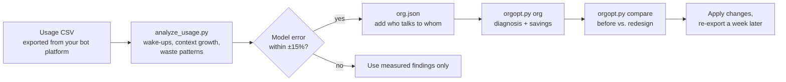

<p align="center">
  
</p>

<p align="center">
  <b>English</b> · <a href="README.zh-TW.md">繁體中文</a>
</p>

<p align="center">
  
  
  
  
</p>

**Your bot usage is climbing and you don't know why?** Most of it is not the work itself. It is bots waking each other up, forwarding messages, and re-reading a context that never stops growing. This repo shows you where the tokens go, and how to rewire your bots so they stop burning them.

- 📊 **Analyze** a usage CSV: per-bot wake-ups, context growth, wasted wake-ups, and when you will hit the long-context price tier.
- 🧮 **Model** your bot team: compare redesigns before you touch anything, with formulas that are tested, not guessed.
- 🤖 **Ask an advisor bot**: drop in a CSV when costs spike and get the three changes that save the most.

---

## Why bots burn tokens

A bot is persistent. **Every time it wakes up, it re-reads its entire context**, so the bill follows one rule:

```
cost ≈ wake-ups × calls per wake-up × context size
```

Shorter messages barely matter, because a message is tiny next to the context it triggers a re-read of. Two things matter: **how often bots wake each other up**, and **how big each bot's context has grown**. Both are decided by how your bots are organized and how they talk.

<p align="center">
  
</p>

Left alone, a bot's context only grows. Every wake-up gets more expensive, and past 200K tokens Grok bills the whole request at double price. Handing over to a fresh chat at 90K cuts this bot's 14-day cost to about **one third**.

## Four habits that quietly double your bill

### 1. A leader that only forwards messages

<p align="center">
  
</p>

Every layer adds two wake-ups per task: one going down, one coming back up. A leader that just passes messages along costs **1.92×** a direct hand-off. A leader earns its place only when it **compresses**: six reports in, one summary up. Then the team is actually cheaper than flat (0.90×), because the most expensive bot, the chief, wakes up once instead of six times.

### 2. "Write it to the board, then ping"

<p align="center">
  
</p>

It looks efficient: a short ping instead of a long message. But the receiver still re-reads its full context to handle the ping, then does it again after fetching the board. Whatever it reads lands in its context anyway. For a chatty bot (k = 0) that is **2× the tokens**. Put small content straight in the message; for large content, say exactly which section to read.

### 3. "OK", "Got it", "Thanks"

A two-token acknowledgement wakes the receiver, and the receiver pays for its **entire context** to read it. Ban pure acknowledgements in your bots' instructions and batch notifications.

### 4. One manager reading everyone's full reports

<p align="center">
  
</p>

Each report wakes the manager and stays in its context. The optimal number of bots per manager follows **k\* ≈ 1 + √(1 + 2·C0 / m)**: send one-line status plus a file path instead of a full report, and one manager can handle far more bots with fewer layers. Platforms add hard limits (a Grok Bot group holds at most 6 bots).

## What fixing it looks like

<p align="center">
  
</p>

The sample team in [`samples/`](samples/) had a relay leader, "OK" replies, board round-trips, a noisy group chat and contexts that were never reset. Fixing those five things takes the modeled weekly cost from **$256 to $25 (0.10×)**. Run it yourself:

```bash
python3 core/orgopt.py compare samples/org_before.json samples/org_after.json
```

## How it works



The analyzer calibrates the model against your real data first. If the model reproduces your actual spend within ±15%, its predictions for a redesign are worth trusting.

## Quick start

No dependencies, just Python 3.

```bash
git clone https://github.com/EndeavorYen/bot-token-optimizer
cd bot-token-optimizer
python3 -m unittest discover -s tests          # 32 tests

# Where are my tokens going?
python3 core/analyze_usage.py usage.csv --platform adapters/grok-bot/platform.json --org-out org.json

# Diagnose the team (fill in "links": who sends what to whom)
python3 core/orgopt.py --platform adapters/grok-bot/platform.json org org.json

# Quick answers
python3 core/orgopt.py board --k 1                      # is "write to board, then ping" worth it?
python3 core/orgopt.py span --n 12 --c0 30000 --m 1000  # how many bots per manager?
python3 core/orgopt.py reset --c 150000 --c-base 8000   # time to hand over to a fresh chat?
```

Column names are auto-detected (`timestamp`, `bot_name`, `input_tokens`, `cached_input_tokens`, `output_tokens`, …). If yours differ: `--map time=Date --map bot=Agent --map input=Prompt`.

## Advisor bot

Turn this repo into an on-demand advisor inside your bot platform. Call it when usage spikes or before a reorg; it collects what it needs in one round of questions and answers with numbers produced only by the tested scripts.

| Call it when… | It will… |
| --- | --- |
| Usage is burning too fast | Analyze your CSV, calibrate, find the waste and the most expensive bot, give the top 3 fixes |
| You want to reorganize | Model the current team and 1–2 options, compare total cost, hotspots and layers |
| You have a "what if" | Answer with the matching formula: board, leader, span, reset |

Setup for Grok Bot: [`adapters/grok-bot/`](adapters/grok-bot/README.md).

## Repository layout

```
core/orgopt.py            cost model: board / scenario / span / reset / org / compare / cost
core/analyze_usage.py     usage CSV analyzer and model calibration
pricing/                  price presets (grok-4.7)
adapters/grok-bot/        platform limits + advisor bot instructions (EN / 中文)
docs/guide.en.md          full guide: model, formulas, decision flow, anti-patterns
docs/images/              figures, generated from the model by make_figures.py
samples/                  example teams (before / after) and a synthetic usage CSV
tests/                    32 tests
```

## Other bot platforms

The model is platform-agnostic; Grok Bot is the first adapter. To add yours, create `adapters/<platform>/platform.json`:

```json
{"name": "My Bot Platform", "pricing": "../../pricing/<preset>.json", "span_cap": 8}
```

Add a pricing preset if needed and adapt the advisor instructions to your platform's limits. PRs welcome.

## Limits

The model gives direction and magnitude, not an exact bill. It assumes every call re-reads the full context, treats context growth as linear, and does not price in the quality loss of long contexts or hand-overs. The Grok Bot CSV column names have not yet been verified against a real export. Details in the [guide](docs/guide.en.md#limits-and-references).

## Learn more

- 📘 [Full guide (English)](docs/guide.en.md) · [完整指引（中文）](docs/guide.zh-TW.md)
- Regenerate the figures: `python3 docs/images/make_figures.py`

## License

[MIT](LICENSE)
