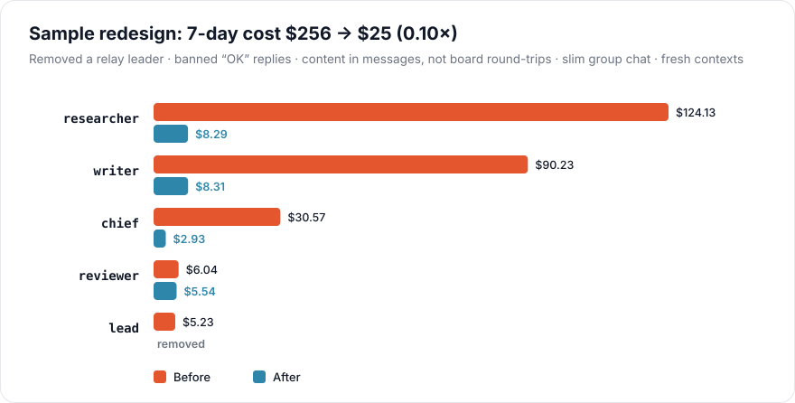
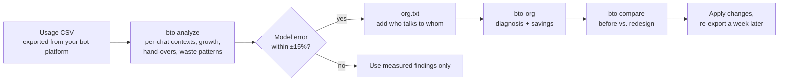

<p align="center">
  
</p>

<p align="center">
  <b>English</b> · <a href="README.zh-TW.md">繁體中文</a>
</p>

<p align="center">
  <a href="https://github.com/EndeavorYen/bot-token-optimizer/actions/workflows/ci.yml"></a>
  
  <a href="https://endeavoryen.github.io/bot-token-optimizer/calculator/"></a>
  
</p>

**Your bot usage keeps climbing and you don't know why?** Most of it is not the work itself. It is bots waking each other up, forwarding messages, and re-reading a context that never stops growing. This repo shows you where the tokens go, and how to rewire your bots so they stop burning them.

- 📊 **Analyze** a usage CSV: wake-ups, context growth and wasted calls per bot and per chat, and when you will hit the long-context price tier.
- 🧮 **Model** your bot team: describe it in a few lines, compare redesigns before you touch anything.
- 🤖 **Ask an advisor bot**: drop in a CSV when costs spike and get the three changes that save the most.
- 🌐 **Try the [web calculator](https://endeavoryen.github.io/bot-token-optimizer/calculator/)**: no install, same formulas.

## Is this for you?

You will probably find savings if two or more of these sound familiar:

- [ ] Usage grows week over week even though the workload is about the same.
- [ ] Your bots reply "OK", "got it" or "thanks" to each other.
- [ ] A bot's job is mostly passing messages from one bot to another.
- [ ] Bots "write it to the board, then ping" instead of sending the content.
- [ ] Some bots have been running in the same chat for weeks.
- [ ] A group chat where every bot posts progress updates.
- [ ] One manager bot reads everyone's full reports.

---

## Why bots burn tokens

A bot is persistent. **Every time it wakes up, it re-reads its entire context**, so the bill follows one rule:

```
cost ≈ wake-ups × calls per wake-up × context size   (+ the output it writes)
```

Shorter messages barely matter, because a message is tiny next to the context it triggers a re-read of. Two things matter: **how often bots wake each other up**, and **how big each bot's context has grown**. Both are decided by how your bots are organized and how they talk.

<p align="center">
  
</p>

Left alone, a bot's context only grows. Every wake-up gets more expensive, and past 200K tokens Grok bills the whole request at double price. Handing over to a fresh chat at 90K cuts this bot's 14-day cost to about **one third**.

## Four habits that quietly double your bill

### 1. A leader that only forwards messages

<p align="center">
  
</p>

Every layer adds two wake-ups per task: one going down, one coming back up. A leader that just passes messages along costs **1.92×** a direct hand-off. A leader earns its place only when it **compresses**: six reports in, one summary up. Then the team is actually cheaper than flat (0.90×), because the most expensive bot, the chief, wakes up once instead of six times.

### 2. "Write it to the board, then ping"

<p align="center">
  
</p>

It looks efficient: a short ping instead of a long message. But the receiver still re-reads its full context to handle the ping, then does it again after fetching the board. Whatever it reads lands in its context anyway. For a chatty bot (k = 0) that is **2× the tokens**. Put small content straight in the message; for large content, say exactly which section to read.

### 3. "OK", "Got it", "Thanks"

A two-token acknowledgement wakes the receiver, and the receiver pays for its **entire context** to read it. Ban pure acknowledgements in your bots' instructions and batch notifications.

### 4. One manager reading everyone's full reports

<p align="center">
  
</p>

Each report wakes the manager and stays in its context. The optimal number of bots per manager follows **k\* ≈ 1 + √(1 + 2·C0 / m)**: send one-line status plus a file path instead of a full report, and one manager can handle far more bots with fewer layers. Platforms add hard limits (a Grok Bot group holds at most 6 bots).

## What fixing it looks like

<p align="center">
  
</p>

The sample team in [`samples/`](samples/) had a relay leader, "OK" replies, board round-trips, a noisy group chat and contexts that were never reset. Fixing those five things takes the **simulated** weekly cost from **$257 to $25 (0.10×)**. This is a model result on example data, not a measured bill; see the [advisor demo](docs/advisor-demo.en.md) for a full consultation, and run it yourself:

```bash
bto compare samples/org_before.txt samples/org_after.txt
```

## How it works



The analyzer treats **every chat as its own context**, spots **hand-overs you already made** (sudden drops in context) so they do not distort growth, and prices **output and reasoning tokens** as well as input. It then calibrates the model against your real spend: if the model reproduces it within ±15%, its predictions for a redesign are worth trusting.

## Quick start

```bash
pip install git+https://github.com/EndeavorYen/bot-token-optimizer
bto --help
```

No dependencies. Or clone the repo and use `python3 core/cli.py` in place of `bto`.

```bash
# Where are my tokens going?
bto analyze usage.csv --platform grok-bot --org-out org.json

# Describe your team by answering a few questions (writes org.txt and org.json)
bto init

# Diagnose the team and compare a redesign
bto org org.txt --platform grok-bot
bto compare org.txt org_redesign.txt

# Quick answers
bto board --k 1                        # is "write to board, then ping" worth it?
bto span --n 12 --c0 30000 --m 1000    # how many bots per manager?
bto reset --c 150000 --c-base 8000     # time to hand over to a fresh chat?
```

Reports come in English or 繁體中文: `--lang en|zh-TW` (default: `BTO_LANG`, then your system locale).

A team fits in a few lines of `org.txt`:

```text
settings horizon=7 soft_cap=120k
bot chief      100k base=8k wakes=3 rounds=1
bot researcher 30k  rounds=3 board
bot writer     30k  rounds=2
chief -> researcher : 6/day 800
researcher -> writer : 6/day 1.5k
writer -> researcher : 6/day 15        # "got it" replies
group team : chief researcher writer : 10/day 900
```

Mistakes are reported with the line number, and every problem at once (unknown bot names, typos in field names, negative numbers).

CSV columns are auto-detected (`timestamp`, `bot_name`, `chat_id`, `input_tokens`, `cached_input_tokens`, `output_tokens`, `reasoning_tokens`, `cost_usd`, …). If yours differ: `--map time=Date --map bot=Agent --map input=Prompt`.

## Advisor bot

Turn this repo into an on-demand advisor inside your bot platform. Call it when usage spikes or before a reorg; it asks what it needs in one round of questions and answers with numbers produced only by the tested scripts. See a [full sample consultation](docs/advisor-demo.en.md).

| Call it when… | It will… |
| --- | --- |
| Usage is burning too fast | Analyze your CSV, calibrate, find the waste and the most expensive bot, give the top 3 fixes |
| You want to reorganize | Model the current team and 1–2 options, compare total cost, hotspots and layers |
| You have a "what if" | Answer with the matching formula: board, leader, span, reset |

Setup for Grok Bot: [`adapters/grok-bot/`](adapters/grok-bot/README.md).

## Pricing and platform presets

`bto presets` lists them. Prices were checked on 2026-10-20 from each vendor's official pricing page; verify before you rely on them.

| Preset | Input / cached / output per 1M tokens | Long-context tier |
| --- | --- | --- |
| `grok-4.7` (default) | $2.00 / $0.50 / $6.00 | ≥ 200K: 2× |
| `gpt-6.1-sol` | $2.00 / $0.10 / $10.00 | > 272K: 2× input, 1.5× output |
| `gpt-6-luna` | $0.10 / $0.01 / $0.50 | > 272K: 2× input, 1.5× output |
| `claude-opus-5-5` | $4.00 / $0.20 / $20.00 | none |
| `claude-sonnet-5-5` | $2.00 / $0.10 / $10.00 | none |
| `claude-haiku-5-5` | $0.10 / $0.01 / $0.50 | > 100K: 5× |
| `gemini-4-argon` | $2.00 / $0.10 / $10.00 | none (prices double from 2026-12-01) |
| `gemini-3.8-flash` | $0.75 / $0.075 / $3.75 | none (prices double from 2027-01-01) |

Platforms: `grok-bot` (group limit 6) and `generic` (span limit 8). Use `--pricing <preset>` to pair any platform with any model.

## FAQ

**Doesn't prompt caching make this moot?** No. Caching lowers the price of each re-read (to 5–25% of input, depending on the vendor), but the number of re-reads is still wake-ups × context size, and many vendors charge more once the prompt crosses a long-context threshold. The model includes your cache hit rate.

**My platform summarizes or trims context automatically.** Then real growth is slower than the model assumes. The analyzer measures growth from your data, so calibration will show it; the advice about wake-ups and relays still applies.

**My platform is a subscription, not per-token.** Dollar figures then mean "cost equivalent". They still rank the options correctly, and token volume usually drives your rate limits or quota.

**Is this about agents in general?** It is aimed at **persistent bots**: long-running, woken repeatedly, with context that accumulates. One-shot agent runs that finish and disappear do not hit these costs.

**How accurate is it?** It gives direction and magnitude. On the synthetic sample the model reproduces actual spend within about 2%, but that data follows the model's own assumptions; run `bto analyze` on your data and check the calibration error.

**Is my CSV sent anywhere?** No. Everything runs locally, with no network calls.

## Repository layout

```
core/                     the bto package: cost model, CSV analyzer, org.txt parser, CLI
core/pricing/             pricing presets (8 models)
core/platforms/           platform presets (grok-bot, generic)
adapters/grok-bot/        advisor bot setup and instructions (EN / 中文)
docs/guide.en.md          full guide: model, formulas, decision flow, anti-patterns
docs/advisor-demo.en.md   a sample consultation with real outputs
docs/calculator/          the web calculator (GitHub Pages), checked against the Python model
docs/images/              figures, generated from the model by make_figures.py
samples/                  example teams, a demo team and a synthetic usage CSV
tests/                    unit tests, plus the calculator parity check
```

## Contributing

The most useful contribution is real data: the column names of your platform's usage export, and the calibration error you get. See [CONTRIBUTING.md](CONTRIBUTING.md).

## Limits

The model gives direction and magnitude, not an exact bill. It assumes every call re-reads the full context and treats growth between hand-overs as linear. It does not price in the quality loss of long contexts or hand-overs, or cache-write premiums on vendors that charge them. Calibration so far is on synthetic data, and the Grok Bot CSV column names have not been verified against a real export. Details in the [guide](docs/guide.en.md#limits-and-references).

## Learn more

- 📘 [Full guide (English)](docs/guide.en.md) · [完整指引（中文）](docs/guide.zh-TW.md)
- 🤖 [Advisor demo (English)](docs/advisor-demo.en.md) · [顧問示範（中文）](docs/advisor-demo.zh-TW.md)
- 🌐 [Web calculator](https://endeavoryen.github.io/bot-token-optimizer/calculator/)

## License

[MIT](LICENSE)
