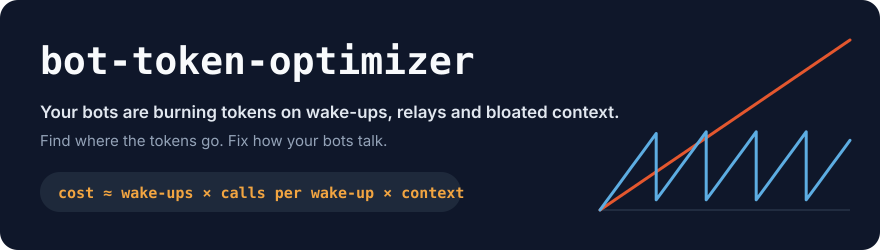
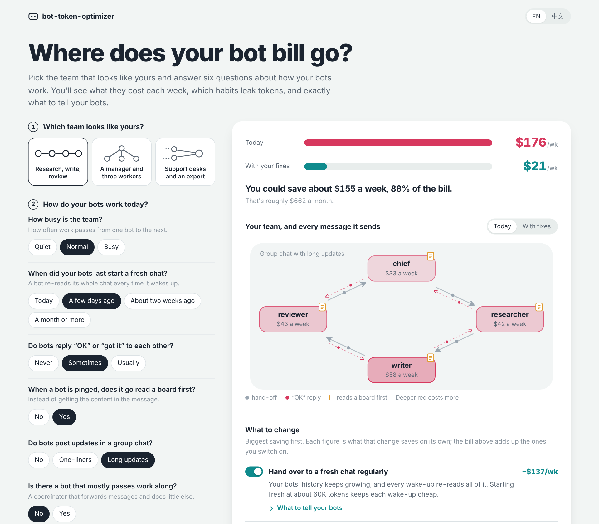
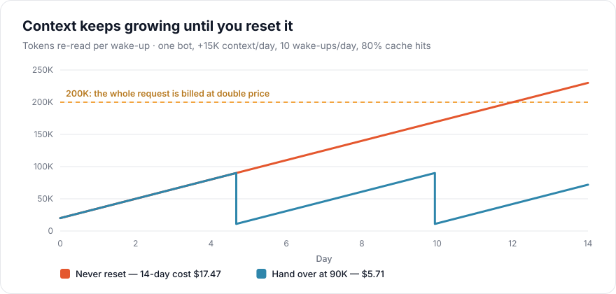
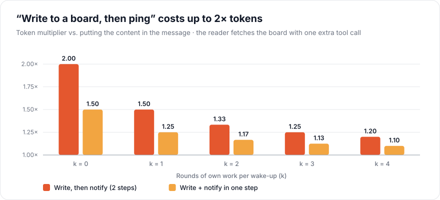
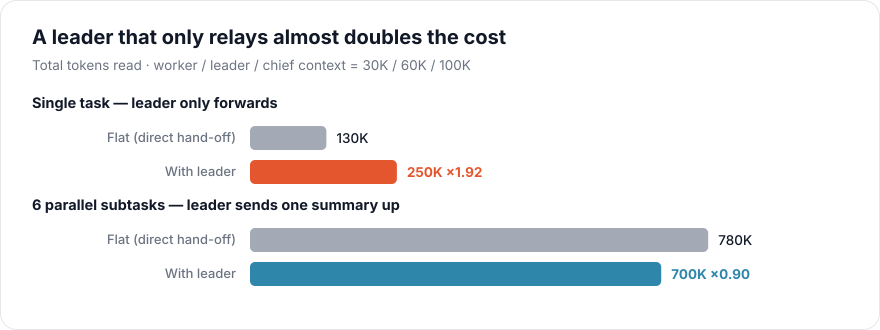
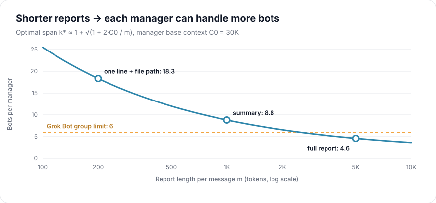
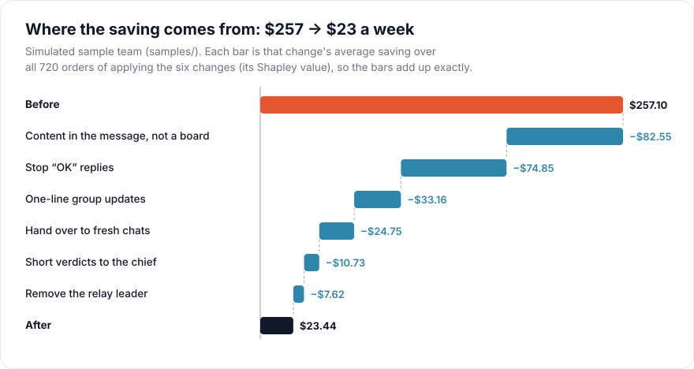
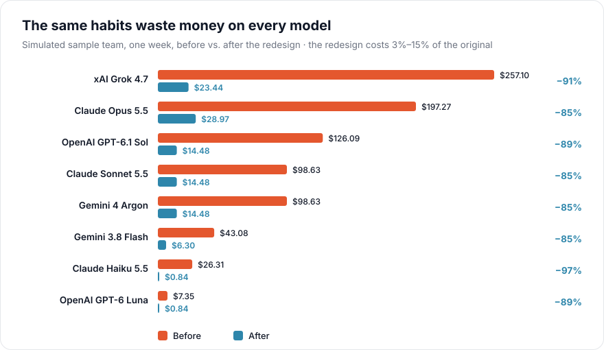
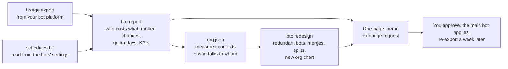
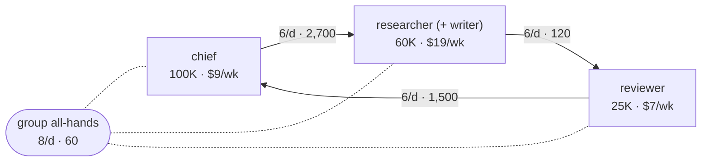

<p align="center">
  
</p>

<p align="center">
  <b>English</b> · <a href="README.zh-TW.md">繁體中文</a>
</p>

<p align="center">
  <a href="pyproject.toml"></a>
  <a href="https://github.com/EndeavorYen/bot-token-optimizer/actions/workflows/ci.yml"></a>
  
  
  <a href="https://endeavoryen.github.io/bot-token-optimizer/calculator/"></a>
  
</p>

**bot-token-optimizer** finds where a team of persistent bots spends its tokens and shows how to stop the waste. It reads your usage export, names the scheduled bots behind each cost when a schedules file can tell them apart, models how they wake each other up, and turns that into a plan: which bot to change, from what to what, how much it saves, and how the organization should look. Every figure comes from formulas you can check and numbers you can reproduce, and every change comes as a request you can paste straight into your bots.

> **In plain words**
>
> 1. A bot re-reads its whole conversation every time it is woken up.
> 2. So your bill depends on how often your bots wake each other up and how long their conversations have grown, far more than on how much work they do.
> 3. Cut the needless wake-ups ("OK" replies, relays, board pings) and start fresh chats regularly, and the same work costs a fraction of what it did (0.09× in our simulated example).

<p align="center">
  <a href="https://endeavoryen.github.io/bot-token-optimizer/calculator/">
    
  </a>
  <br>
  <sub><a href="https://endeavoryen.github.io/bot-token-optimizer/calculator/"><b>Open the web calculator</b></a>: no install, same model as the command-line tool.</sub>
</p>

## Quick start

Two steps and about ten minutes: create the Token Advisor in Grok Bot, then tell it your goal. It looks up everything else itself.

### Step 1 · Create the Token Advisor

Pick one of three ways:

| | Way | Good for |
| :---: | --- | --- |
| **A** | [From the shared template](#a-from-the-shared-template-coming-soon) *(coming soon)* | the fastest start |
| **B** | [Ask your main bot](#b-ask-your-main-bot) | the usual way on Grok Bot |
| **C** | [Set it up from the repo](#c-set-it-up-from-the-repo) | full control |

#### A. From the shared template (coming soon)

> The template is not published yet. Until it is, use **B** or **C**.

1. Open the Token Advisor template <!-- template-link --> and create a bot from it.
2. Templates do not always carry access to your other bots, so tell your main bot:

   > Give Token Advisor read-only access to every bot's settings, and keep it out of all groups, schedules and automations.

It does not matter whether the template brings the repo along: on first use the advisor clones the tools into its workspace itself, and pulls the latest version on every later use.

#### B. Ask your main bot

1. Open a **new chat** with your main bot, so this setup is not re-read on its every later wake-up.
2. Paste:

```text
Please create a new bot with exactly this specification. Do not add, drop or "improve" anything:

1. Name: Token Advisor
2. Purpose: only when I message it directly, analyze my bot team's token spend and give advice.
3. Workspace: clone https://github.com/EndeavorYen/bot-token-optimizer into its workspace (folder bot-token-optimizer). It must be able to run python3 there.
4. Instructions: set the FULL text of adapters/grok-bot/ADVISOR_BOT.en.md from that repo as its instructions, verbatim. Do not summarize, rewrite or drop anything, and add no rules of your own.
5. Wake-ups: no groups, no schedules, no automations, no notifications. It wakes only when I message it.
6. Permissions: it may READ every bot's settings (instructions, schedules and automations, groups, chat length) but must not change any bot.

When done, report only: (a) its name, (b) the first line of its instructions, (c) the last "## " heading in them, (d) the output of python3 core/cli.py --version in its workspace, (e) whether it can read the other bots' settings.
```

#### C. Set it up from the repo

1. Create a bot named "Token Advisor".
2. Paste the whole of [`ADVISOR_BOT.en.md`](adapters/grok-bot/ADVISOR_BOT.en.md) as its instructions, unchanged ([`ADVISOR_BOT.zh-TW.md`](adapters/grok-bot/ADVISOR_BOT.zh-TW.md) for Chinese).
3. Allow it to run `python3` and `git` in its workspace (it clones this repo itself on first use; you can also clone it there yourself).
4. Give it read-only access to the other bots' settings.
5. Keep it out of groups, schedules and automations.

#### Check that it works

Whichever way you chose, confirm three things:

- [ ] Its instructions start with `# Token Cost Advisor (Grok Bot) — playbook` and end with the `## Ground rules` section.
- [ ] `python3 core/cli.py --version` in its workspace prints the same version as the badge at the top of this page.
- [ ] It can read the other bots' settings.

Something off, or want a trial run with known answers? See the [step-by-step guide](adapters/grok-bot/SETUP.en.md).

<br>

### Step 2 · Tell it your goal

1. Open a new chat with the Token Advisor.
2. Attach your Grok Bot usage export (the usage-events CSV).
3. Send one sentence, for example:

```text
I want 100% of the quota to last the full 7 days. Also, can the organization be leaner? Tell me who is redundant, which bots should be merged or split, and give me the best org chart.
```

It reads your bots' schedules, instructions and groups itself, then replies with:

- the bottom line in dollars per week, and the bot that costs most;
- concrete changes with their savings, and how many days the quota will last;
- the current and proposed org charts;
- one change request for your main bot. Nothing changes until you say "send it".

More things to ask it: [everyday use](adapters/grok-bot/SETUP.en.md#step-5-everyday-use).

<br>

### Prefer the command line?

```bash
pip install git+https://github.com/EndeavorYen/bot-token-optimizer
bto report usage.csv --platform grok-bot --tz +08:00 --quota-days 3 --out memo.md
bto redesign org.txt --keep chief
```

No dependencies. Every command is in the [command reference](#command-reference).

## Contents

- [Quick start](#quick-start)
- [At a glance](#at-a-glance)
- [Is this for you?](#is-this-for-you)
- [Why bots burn tokens](#why-bots-burn-tokens)
- [The cost model](#the-cost-model)
- [What fixing it looks like](#what-fixing-it-looks-like)
- [How it works](#how-it-works)
- [From a usage export to a plan](#from-a-usage-export-to-a-plan)
- [Redesigning the organization](#redesigning-the-organization)
- [Command reference](#command-reference)
- [Advisor bot](#advisor-bot)
- [Pricing and platform presets](#pricing-and-platform-presets)
- [How the numbers are checked](#how-the-numbers-are-checked)
- [FAQ](#faq) · [Limits](#limits) · [Contributing](#contributing) · [Citing](#citing)

## At a glance

| Habit | What it does to the bill | Details |
| --- | --- | --- |
| A leader that only forwards messages | **1.92×** the tokens of a direct hand-off | [Relay leaders](#relay-leaders) |
| "Write it to the board, then ping" | up to **2.00×** the tokens per notification | [Board round-trips](#board-round-trips) |
| "OK" / "got it" replies | each one costs the receiver a **full context read** | [Cost model](#the-cost-model) |
| Never starting a fresh chat | **3×** the 14-day cost of handing over at 90K | [Hand-overs](#hand-overs) |
| A bot polling every 30 minutes that usually finds nothing | half of all spend in our synthetic export; every 2 hours instead saves **$41–59 a week** | [From export to plan](#from-a-usage-export-to-a-plan) |
| A relay in the chain, two bots passing drafts back and forth | the formula retires one and merges the other: **0.51×** with the instruction fixes | [Redesign](#redesigning-the-organization) |
| All of the above, fixed (sample team) | **$257 → $23 a week, 0.09×** | [Results](#what-fixing-it-looks-like) |

Figures are simulated with the model in [`core/`](core/) on the example data in [`samples/`](samples/), and regenerated by CI on every change.

## Is this for you?

You will probably find savings if two or more of these sound familiar:

- [ ] Usage grows week over week even though the workload is about the same.
- [ ] Your bots reply "OK", "got it" or "thanks" to each other.
- [ ] A bot's job is mostly passing messages from one bot to another.
- [ ] Bots "write it to the board, then ping" instead of sending the content.
- [ ] A shared board that every bot reads in full and nobody trims.
- [ ] Some bots have been running in the same chat for weeks.
- [ ] A group chat where every bot posts progress updates.
- [ ] One manager bot reads everyone's full reports.
- [ ] Scheduled bots wake every few minutes, mostly to find nothing to do.
- [ ] Your quota runs out days before it resets.

It is built for **persistent bots**: long-running, woken repeatedly, with a context that accumulates. One-shot agent runs that finish and disappear do not hit these costs.

## Why bots burn tokens

A persistent bot **re-reads its entire context every time it wakes up**. A two-word message is cheap to write and expensive to receive, because the receiver pays for everything it has ever seen in that chat. So the bill is driven by two things only: how often bots wake each other up, and how large each context has grown. Both are decided by how your bots are organized and how they talk.

<p align="center">
  
</p>

Left alone, a context only grows, so every wake-up costs more than the last; past 200K tokens Grok bills the whole request at double price. In this example, handing over to a fresh chat at 90K cuts the bot's 14-day cost from **$17.47 to $5.71**.

## The cost model

For a team of bots $b$ over a period, the model estimates

$$
\text{cost} \;\approx\; \sum_{b} \Big(\, W_b \, R_b \, \overline{C}_b \, p_b \;+\; W_b \, O_b \, o \,\Big),
\qquad p_b = h_b\, r + (1 - h_b)
$$

with every price multiplied by the vendor's long-context factor $\lambda$ once a prompt crosses its threshold.

| Symbol | Meaning | Typical value |
| --- | --- | --- |
| $W$ | wake-ups per day (messages received, plus the user and schedules) | 5–20 |
| $R = 1 + k$ | calls per wake-up: one to read the message, $k$ for the bot's own tool work | 1–4 |
| $\overline{C}$ | average context over the period; grows with everything received, read and written | 10K–300K |
| $h$, $r$ | cache hit rate; cached price as a fraction of the input price | 0.8; 0.05–0.25 |
| $O$, $o$ | output per wake-up (including reasoning); output price as a multiple of input | 300; 3–5 |
| $\lambda$ | long-context multiplier (Grok 2× at 200K, Claude Haiku 5× above 100K, …) | 1–5 |

Three consequences drive everything below. A message of length $m$ is tiny next to $C$, so shortening messages barely helps. Every extra wake-up costs a full $C$. And whatever a bot reads stays in its $C$ for every later wake-up.

### Board round-trips

When the receiver fetches content from a board with a tool call, each notification costs one extra full read. With $k$ rounds of the bot's own work per wake-up:

$$
\frac{\text{tokens with a board}}{\text{tokens sent directly}} =
\begin{cases}
\dfrac{k+2}{k+1} & \text{sender writes, then notifies} \\[2ex]
1 + \dfrac{1}{2(k+1)} & \text{write and notify in one step}
\end{cases}
$$

<p align="center"></p>

The ratio does not depend on message length, only on how much a bot does per wake-up, which is why chatty bots ($k = 0$) pay double. `bto board --k 1`

### Relay leaders

With worker, leader and chief contexts $C_w, C_\ell, C_c$, one task costs $C_w + C_c$ handed over directly and $C_w + 2C_\ell + C_c$ through a relay. For $n$ parallel subtasks, a leader that merges them into one summary costs $nC_w + (n+1)C_\ell + C_c$ instead of $nC_w + nC_c$.

<p align="center"></p>

A layer pays for itself only when it **compresses** reports for a more expensive reader. `bto scenario relay` · `bto scenario aggregate --n 6`

### Span of control

A manager is woken by every report it receives, and the reports accumulate in its context. With base context $C_0$ and reports of $m$ tokens, the cheapest number of bots per manager is

$$
k^{*} \;\approx\; 1 + \sqrt{1 + \frac{2\,C_0}{m}}
$$

<details>
<summary>Derivation</summary>

Collecting $k$ reports costs the manager $\sum_{i=1}^{k} (C_0 + i\,m) \approx k\,C_0 + \tfrac{1}{2} m k^2$. A tree over $N$ workers needs about $N/(k-1)$ managers, so the total is

$$
f(k) = \frac{N}{k-1}\Big(k\,C_0 + \tfrac{1}{2}\,m\,k^2\Big).
$$

Setting $f'(k) = 0$ gives $k^2 - 2k - 2C_0/m = 0$, whose positive root is $k^{*}$. `bto span` also solves the exact integer problem numerically, and by default adds the wake-up each manager spends receiving its own assignment; without that extra wake-up, the numerical optimum and $k^{*}$ agree within one bot.
</details>

<p align="center"></p>

Replace full reports with one line and a file path, and one manager can handle about four times as many bots. Platforms add hard limits (a Grok Bot group holds at most 6). `bto span --n 12 --c0 30000 --m 1000`

### Hand-overs

Moving a bot to a fresh chat costs one read of the old context to write a summary of $H$ tokens, plus the first read of the new context $C_{\text{new}} = C_{\text{base}} + H$. Every later wake-up then saves $R\,p\,(C - C_{\text{new}})$, so the hand-over pays for itself after

$$
n^{*} \;=\; \frac{p\,C + H\,o + C_{\text{new}}}{R\,p\,\big(C - C_{\text{new}}\big)} \quad \text{wake-ups.}
$$

For an 8K base, a 3K summary and 80% cache hits on Grok, $n^{*}$ is 2.6 at 50K, 1.7 at 100K and 1.4 at 150K. In tokens, a hand-over almost always pays off within a few wake-ups; the real constraints are the knowledge lost in the summary and the effort of doing it, so hand over on a schedule. `bto reset --c 150000 --c-base 8000`

## What fixing it looks like

The sample team in [`samples/`](samples/) has a relay leader, "OK" replies, board round-trips, a noisy group chat, full reports to the chief and contexts that were never reset. The chart splits the saving between the six changes. Because the changes interact (removing a bot changes how often the others are woken), each bar is that change's average saving over all 720 orders of applying them, its Shapley value, so the bars add up exactly.

<p align="center"></p>

The same habits waste money whatever the model. Cheaper models shrink the bill but not the share that is wasted, and models with a steep long-context tier gain the most from fresh chats (Claude Haiku: −97%).

<p align="center"></p>

These are simulated figures for example data, not a measured bill. The [advisor demo](docs/advisor-demo.en.md) walks through a full engagement; reproduce the comparison with `bto compare samples/org_before.txt samples/org_after.txt`.

## How it works



The analyzer treats **every chat as its own context**, detects **hand-overs you already made** (sharp drops in context) so they do not distort growth, and prices **output and reasoning tokens** along with input. It then calibrates the model against your real spend; only if the model reproduces it within ±15% are its predictions for a redesign worth trusting. `bto report` turns all of this into a one-page memo: the bottom line in dollars per week, ranked actions labeled measured, modeled or judgment, the data gaps and how to close them, a change request ready to paste to the bot that manages the others, and KPIs with a check date ([example](docs/sample-memo-grok.en.md)). When the export cannot tell bots apart, `--schedules` matches each bot's schedule against the wake-up times to name them.

`bto org` diagnoses a team you describe, and `bto compare` checks a redesign you wrote yourself. A diagnosis looks like this (trimmed):

```text
$ bto org samples/org_before.txt --platform grok-bot

## Organization cost estimate (7 days)
Total: about 128,548,279 input-token equivalents (about $257.10), of which output $0.89

| Bot        | C now   | C at end | Wake-ups/day | Calls/day | Share | USD equiv. |
| researcher | 30,000  | 348,430  | 14.0         | 70.0      | 48%   | $124.39    |
| writer     | 30,000  | 324,070  | 14.0         | 56.0      | 35%   | $90.48     |
| chief      | 100,000 | 249,100  | 11.0         | 22.0      | 12%   | $30.75     |
...
Longest hand-off chain: 5 hops (chief → lead → researcher → writer → reviewer → chief)

1. [ack] researcher: writer → researcher: 6 messages/day averaging 15 tokens — likely “OK / got it” ...
2. [ack] writer: reviewer → writer: 6 messages/day averaging 15 tokens ...
3. [board_tool_read] researcher: reads the board via a tool after each notification ...
```

## From a usage export to a plan

`bto report` reads the export and writes a one-page memo: the bottom line in dollars per week, who costs what, ranked changes, data gaps and how to close them, KPIs with a check date, and one change request for the bot that manages the others. On the synthetic Grok export in [`samples/`](samples/) with "the quota lasts 3 days, I need 7" ([full memo](docs/sample-memo-grok.en.md)):

> 1. At the current pace your bots cost about **$158 per week**. The quota lasts 3 days; lasting 7 means getting down to about **$68 per week**.
> 2. 98% of it is re-reading context rather than writing output. A single bot, **monitor**, is 50% of all spend (schedule: every 30m).
> 3. The recommendations save about **$72–119 per week**, counting each dollar once; with them the quota lasts about **5.5–12.0 days**.

| Change | Saves / week | Evidence |
| --- | --- | --- |
| monitor: every 30 min → every 2 h (64% of its checks find nothing to do) | $41–59 | measured |
| Hand over to a fresh chat: monitor and digest at 40K tokens, the rest at 100K | $25–50 | modeled |
| heartbeat: every 1 h → every 3 h | $2 | measured |

How each number is made:

- **Naming the bots.** Grok's export has no bot id, so calls are grouped by model. Scheduled bots wake at known times: a wake-up starting between 60 s before and 5 min after a fire is given to that schedule, nearest first, one wake-up per fire. Each bot then has its own spend, cost per wake-up, context and share of checks with nothing to do (one call, ≤ 80 output tokens). What no schedule claims is unattributed traffic (your messages, bot-to-bot pings, and event-triggered automations). `bto report --events events.tsv` (lines: `timestamp<TAB>source`) gives a wake-up that starts 0–30 s after a logged event to that source, nearest first, one wake-up per event, with the same chance check as schedules.
- **Fewer scheduled checks.** With idle share $u$, the new interval is the old one $\div (1-u)$, rounded up to a round value; the saving is the measured cost per wake-up × the wake-ups removed.
- **Hand-over thresholds.** For each context and each threshold $T$ from 40K to 150K, with a fresh chat starting at $C_f$ and growth $G$ tokens a week:

$$
n_T = \frac{G}{T - C_f}, \qquad \text{saving}_T = W R\,p\,\Big(C - \frac{C_f + T}{2}\Big) - n_T \cdot \text{rebuild}
$$

  Each context gets the $T$ that saves most with $n_T \le 7$ hand-overs a week (adjustable). A context that cannot stay within the limit is reported as a decision with its price, never silently dropped.
- **Board size.** In a read-then-work wake-up, the second call's prompt minus the first call's prompt and answer is what the first call fetched. A median of thousands of tokens means a whole board is read; a rising median means it is growing. Everything fetched stays in the context for every later wake-up, so the memo compares reading the whole board with reading only the needed section (about 2K tokens) after a clean-up, and prices the hand-overs on the slower growth that follows. `bto board --board 12000 --section 2000` shows the three options (whole board, section, section in the message) for any figures.
- **Quota days.** At weekly spend $S$ the quota lasting $d$ days is worth $Q = S\,d/7$. Lasting $d^{*}$ days needs $S \le 7Q/d^{*}$; after saving $\Delta S$ it lasts $7Q/(S - \Delta S)$ days. `bto quota` does the same arithmetic for any figures. A zero-row stretch longer than `--max-gap` is only a candidate quota gap. It counts when at least 3 full clock hours inside it are hours this export is normally busy: an hour-of-day is busy when it has calls on at least half as many dates as the busiest hour, and a weekday with no rows still counts at those hours except a rest day. A rest day is a weekday whose full dates (at least 2) are all empty. Days and hours use `--tz` when it is set, otherwise the quiet-point clock (the middle of the longest run of UTC hours that are not busy). Under two weeks, rest days are not judged and a warning is printed. If an outage empties every full date of a weekday, that weekday is treated as rest. A normally off weekday that was worked even once (for example one Saturday with traffic) is no longer treated as a rest day, so the other empty dates of that weekday can be counted as quota gaps and raise the weekly rate and can infer a quota cycle that does not exist. Improved off-day detection is tracked in [#12](https://github.com/EndeavorYen/bot-token-optimizer/issues/12). Overnight quiet and rest days are not quota gaps. When a stretch does count, the weekly rate, every saving and the quota math use active days (calendar span minus those gaps) as the denominator, and the memo names each gap, its length and that denominator. Spend from the previous resume, or from the export start, up to the gap is a measured quota cycle. The cycle that starts at the export boundary is partial. When `--quota-days` is omitted, only the latest complete cycle's length is used, rounded to one decimal. Otherwise quota days are omitted unless `--quota-days` is given.
- **Each dollar once.** A hand-over is priced on the wake-ups left after the schedule changes, idle checks are not counted again as acknowledgements, and cache savings shrink with the contexts. Measured, modeled and judgment figures are labeled; judgment ranges never enter the total.

## Redesigning the organization

`bto redesign org.txt` searches for a cheaper organization of the same bots. It tries one change at a time and keeps the one that saves most, until nothing saves at least 2% of the total:

| Change | Tried when | The formula weighs |
| --- | --- | --- |
| Drop acknowledgements, read only the needed board section, content in the message, one-line group status | always | wake-ups, board reads and board content removed |
| **Retire** a bot | one upstream, one downstream, no tool work or own wake-ups, passes on about what it receives | its context is no longer read; the hand-off goes direct |
| **Merge** two bots | they hand work to each other, or share a manager | one context and no hand-off wake-ups, against a larger context (both bases kept, the day's work conserved) read on every wake-up |
| **Split** a bot | it serves three or more sources | two smaller contexts, against a short summary exchanged twice a day |
| **Add leaders** | a manager has more direct reports than the span limit | group size from $k^{*}$; each leader passes on one summary per round |

Structures are compared fairly: over four weeks, under the same hand-over policy, and with every context that will cycle starting from a fresh chat. Bots marked `keep` are never retired or merged away. On the sample team ([full output](docs/sample-redesign.en.md)), with the chief and the reviewer kept, the instruction fixes take it from $62.87 to $36.39 a week; retiring the relay **lead** and merging **writer** into **researcher** bring it to **$32.33 (0.51×)**:



The formula cannot tell whether two jobs belong together, so every merge carries a check: same tools and access, and neither reviews the other. The advisor vets each one before proposing it. `bto report --org-out` writes a skeleton from the measured contexts and named bots to start from. Because every option is compared under a hand-over policy, the redesign's baseline is lower than `bto org`'s, which assumes contexts are never reset.

## Command reference

Install with `pip install git+https://github.com/EndeavorYen/bot-token-optimizer` (no dependencies), or run `python3 core/cli.py` from a clone.

| Task | Command |
| --- | --- |
| One-page memo: where the money goes, what to change first | `bto report usage.csv --platform grok-bot --tz +08:00 --quota-days 3` |
| Name the bots inside a bucket from their schedules | `bto report usage.csv --schedules schedules.txt --tz +08:00` |
| Budget and quota days, for any figures | `bto quota --week-usd 2536 --days-now 3 --save 560 630` |
| Spend per day and what changed | `bto trend usage.csv --tz +08:00` |
| Per-context detail | `bto analyze usage.csv --platform grok-bot` |
| Org skeleton of the measured contexts and named bots | `bto report usage.csv --schedules schedules.txt --org-out org.json` |
| Describe your team by answering questions | `bto init` |
| Diagnose the team | `bto org org.txt --platform grok-bot` |
| Who is redundant, what to merge or split, the best org chart | `bto redesign org.txt --keep chief --out after.txt` |
| Compare a redesign you wrote | `bto compare org.txt org_redesign.txt` |
| Is a board round-trip worth it? What does a big board cost? | `bto board --k 1 --board 12000 --section 2000` |
| How many bots per manager? | `bto span --n 12 --c0 30000 --m 1000` |
| Time for a fresh chat? | `bto reset --c 150000 --c-base 8000` |
| List pricing and platform presets | `bto presets` |

Reports come in English or 繁體中文 (`--lang en|zh-TW`; default `BTO_LANG`, then your system locale). A team fits in a few lines of `org.txt`:

```text
settings horizon=7 soft_cap=120k handover_at=60k
bot chief      100k base=8k wakes=3 rounds=1 keep
bot researcher 30k  rounds=3 board
bot writer     30k  rounds=2
chief -> researcher : 6/day 800
researcher -> writer : 6/day 1.5k
writer -> researcher : 6/day 15        # "got it" replies
group team : chief researcher writer : 10/day 900
```

`keep` marks a bot that must not be retired or merged away; `handover_at` evaluates the team under a hand-over policy. A schedules file is just as short: `monitor every 30m`, `digest at 09:00,18:00`, `sync cron */15 9-18 * * 1-5`. Mistakes are reported with their line numbers, all at once. CSV columns are detected automatically (`timestamp`, `bot_name`, `chat_id`, `input_tokens`, `cached_input_tokens`, `output_tokens`, `reasoning_tokens`, `cost_usd`, …); map others with `--map time=Date --map bot=Agent`.

## Advisor bot

Turn this repo into an on-demand cost consultant inside your bot platform. It frames your goal, then investigates on its own (it reads your bots' schedules, instructions and groups instead of asking you), diagnoses, and recommends concrete changes: which bot, which setting, from what to what, how much it saves and how sure it is, written as one request the managing bot can execute. It closes with the decisions only you can make and KPIs with a check date. Every number comes from the tested tools, and it still answers when the data is imperfect, saying how sure it is and how to find out. See a [sample engagement](docs/advisor-demo.en.md).

| Call it when… | You get… |
| --- | --- |
| Usage is burning too fast | It looks up your bots' schedules and rules itself, then gives a three-sentence bottom line naming the costliest bot, concrete changes with $/week, a change request for the main bot and a [one-page memo](docs/sample-memo-grok.en.md) |
| You want to reorganize | Who is redundant, which bots to merge or split, the current and proposed org charts with the savings of each change ([example](docs/sample-redesign.en.md)), and the change request |
| You have a "what if" | The answer first, then the number from the matching tool: board, leader, span, hand-over |

Setup for Grok Bot: a [step-by-step guide](adapters/grok-bot/SETUP.en.md) with every message to paste into your existing bot, plus the [adapter notes](adapters/grok-bot/README.md).

## Pricing and platform presets

Prices were checked on 2026-10-20 against each vendor's official pricing page; verify them before relying on the dollar figures.

| Preset | Input / cached / output per 1M tokens | Long-context tier |
| --- | --- | --- |
| `grok-4.7` (default) | $2.00 / $0.50 / $6.00 | ≥ 200K: 2× |
| `gpt-6.1-sol` | $2.00 / $0.10 / $10.00 | > 272K: 2× input, 1.5× output |
| `gpt-6-luna` | $0.10 / $0.01 / $0.50 | > 272K: 2× input, 1.5× output |
| `claude-opus-5-5` | $4.00 / $0.20 / $20.00 | none |
| `claude-sonnet-5-5` | $2.00 / $0.10 / $10.00 | none |
| `claude-haiku-5-5` | $0.10 / $0.01 / $0.50 | > 100K: 5× |
| `gemini-4-argon` | $2.00 / $0.10 / $10.00 | none (prices double from 2026-12-01) |
| `gemini-3.8-flash` | $0.75 / $0.075 / $3.75 | none (prices double from 2027-01-01) |

Platforms: `grok-bot` (group limit 6) and `generic` (span limit 8). Pair any platform with any model using `--pricing <preset>`.

## How the numbers are checked

| Check | What it guarantees |
| --- | --- |
| 105 unit tests | Every formula and table in this README and the guide is reproduced from hand-calculated values; the advisor's setup guide quotes answers the tests check |
| 1,083 parity checks | The web calculator computes exactly what the Python model computes, and no fix in the calculator ever raises the bill across 192 answer combinations |
| Figures and samples in CI | All charts, the sample memos and the sample redesign are regenerated on every push; CI fails if any is stale |
| Calibration | `bto analyze` reproduces the actual spend of the synthetic sample within 2.1%; on your data it reports the error so you can judge |
| Shapley attribution | The savings breakdown adds up exactly and does not depend on the order of the changes |

## FAQ

<details>
<summary><b>Doesn't prompt caching make this moot?</b></summary>

No. Caching lowers the price of each re-read (to 5–25% of input, depending on the vendor), but the number of re-reads is still wake-ups × context, and many vendors charge more once a prompt crosses a long-context threshold. The model includes your cache hit rate.
</details>

<details>
<summary><b>My platform summarizes or trims context automatically.</b></summary>

Then real growth is slower than the model assumes. The analyzer measures growth from your own data, so calibration will show it; the advice about wake-ups and relays still applies.
</details>

<details>
<summary><b>My platform is a subscription, not per-token.</b></summary>

Dollar figures then mean "cost equivalent". They still rank the options correctly, and token volume usually drives your quota or rate limits.
</details>

<details>
<summary><b>How accurate is it?</b></summary>

It gives direction and magnitude. On the synthetic sample the model reproduces actual spend within about 2%, but that data follows the model's own assumptions. Run `bto analyze` on your data and check the calibration error.
</details>

<details>
<summary><b>My export cannot tell the bots apart.</b></summary>

Common on Grok Bot, where Automation ID is often empty. List each bot's schedule in a schedules file and run `bto report --schedules`: scheduled wake-ups are matched to their bots by time, and what is left is shown as unattributed traffic (your messages, bot-to-bot pings, and event-triggered automations). Pass event start times with `--events` to attribute event-triggered chains to their source. The advisor bot reads the schedules from the bots' settings itself.
</details>

<details>
<summary><b>Will it change or delete my bots?</b></summary>

No. The tools only calculate. The advisor bot reads other bots' settings but never changes them: it writes a change request, and the bot that manages the others applies it only after you approve. Bots to retire are paused, not deleted.
</details>

<details>
<summary><b>Is my CSV sent anywhere?</b></summary>

No. Everything runs locally with no network calls, including the web calculator, which runs entirely in your browser.
</details>

## Limits

The model gives direction and magnitude, not an exact bill. It assumes every call re-reads the full context and treats growth between hand-overs as linear. It does not price the quality loss of long contexts or hand-overs, or cache-write premiums on vendors that charge them. Calibration so far is on synthetic data. The Grok Bot usage-events export is read as is, but it has no chat id and its Automation ID is often empty, so calls are grouped by model; schedules name the scheduled bots, while unattributed traffic stays mixed and its growth (and so its hand-over count) is a lower estimate. A schedule matched little more often than chance is flagged. The redesign search is greedy and judges cost only: whether two jobs can share a bot is for a person to decide. Details in the [guide](docs/guide.en.md#limits-and-references).

## Repository layout

```
core/                     the bto package: cost model, CSV analyzer, schedule matching, advice and memo, org redesign, org.txt parser, CLI
core/pricing/             pricing presets (8 models)
core/platforms/           platform presets (grok-bot, generic)
adapters/grok-bot/        step-by-step setup, adapter notes and the consultant playbook (EN / 中文)
docs/guide.en.md          the full guide: model, formulas, decision flow, anti-patterns
docs/advisor-demo.en.md   a sample engagement with real outputs
docs/sample-memo*.en.md   one-page memos `bto report` writes (make_memos.py regenerates them)
docs/sample-redesign.en.md  what `bto redesign` proposes for the sample team
docs/make_memos.py        regenerates the sample memos and redesign (checked in CI)
docs/calculator/          the web calculator (GitHub Pages), checked against the Python model
docs/images/              figures, generated from the model by make_figures.py
samples/                  example teams, a demo team, a synthetic usage CSV, a Grok export generator and its schedules
tests/                    unit tests and the calculator parity check
```

## Contributing

The most useful contribution is real data: the column names of your platform's usage export, and the calibration error you get. See [CONTRIBUTING.md](CONTRIBUTING.md).

## Citing

If this helps your work, please cite it (GitHub's "Cite this repository" button reads [`CITATION.cff`](CITATION.cff)):

```bibtex
@software{bot_token_optimizer,
  author = {EndeavorYen},
  title  = {bot-token-optimizer: token cost modeling for teams of persistent bots},
  year   = {2026},
  url    = {https://github.com/EndeavorYen/bot-token-optimizer}
}
```

## License

[MIT](LICENSE)
