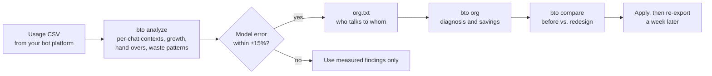

<p align="center">
  
</p>

<p align="center">
  <b>English</b> · <a href="README.zh-TW.md">繁體中文</a>
</p>

<p align="center">
  <a href="https://github.com/EndeavorYen/bot-token-optimizer/actions/workflows/ci.yml"></a>
  
  
  <a href="https://endeavoryen.github.io/bot-token-optimizer/calculator/"></a>
  
</p>

**bot-token-optimizer** finds where a team of persistent bots spends its tokens and shows how to stop the waste. It reads your usage export, models how your bots wake each other up, and ranks the changes that save the most: with formulas you can check, numbers you can reproduce, and instructions you can paste straight into your bots.

<p align="center">
  <a href="https://endeavoryen.github.io/bot-token-optimizer/calculator/">
    
  </a>
  <br>
  <sub><a href="https://endeavoryen.github.io/bot-token-optimizer/calculator/"><b>Open the web calculator</b></a>: no install, same model as the command-line tool.</sub>
</p>

## Contents

- [At a glance](#at-a-glance)
- [Is this for you?](#is-this-for-you)
- [Why bots burn tokens](#why-bots-burn-tokens)
- [The cost model](#the-cost-model)
- [What fixing it looks like](#what-fixing-it-looks-like)
- [How it works](#how-it-works)
- [Quick start](#quick-start)
- [Advisor bot](#advisor-bot)
- [Pricing and platform presets](#pricing-and-platform-presets)
- [How the numbers are checked](#how-the-numbers-are-checked)
- [FAQ](#faq) · [Limits](#limits) · [Contributing](#contributing) · [Citing](#citing)

## At a glance

| Habit | What it does to the bill | Details |
| --- | --- | --- |
| A leader that only forwards messages | **1.92×** the tokens of a direct hand-off | [Relay leaders](#relay-leaders) |
| "Write it to the board, then ping" | up to **2.00×** the tokens per notification | [Board round-trips](#board-round-trips) |
| "OK" / "got it" replies | each one costs the receiver a **full context read** | [Cost model](#the-cost-model) |
| Never starting a fresh chat | **3×** the 14-day cost of handing over at 90K | [Hand-overs](#hand-overs) |
| All of the above, fixed (sample team) | **$257 → $23 a week, 0.09×** | [Results](#what-fixing-it-looks-like) |

Figures are simulated with the model in [`core/`](core/) on the example data in [`samples/`](samples/), and regenerated by CI on every change.

## Is this for you?

You will probably find savings if two or more of these sound familiar:

- [ ] Usage grows week over week even though the workload is about the same.
- [ ] Your bots reply "OK", "got it" or "thanks" to each other.
- [ ] A bot's job is mostly passing messages from one bot to another.
- [ ] Bots "write it to the board, then ping" instead of sending the content.
- [ ] Some bots have been running in the same chat for weeks.
- [ ] A group chat where every bot posts progress updates.
- [ ] One manager bot reads everyone's full reports.

It is built for **persistent bots**: long-running, woken repeatedly, with a context that accumulates. One-shot agent runs that finish and disappear do not hit these costs.

## Why bots burn tokens

A persistent bot **re-reads its entire context every time it wakes up**. A two-word message is cheap to write and expensive to receive, because the receiver pays for everything it has ever seen in that chat. So the bill is driven by two things only: how often bots wake each other up, and how large each context has grown. Both are decided by how your bots are organized and how they talk.

<p align="center">
  
</p>

Left alone, a context only grows, so every wake-up costs more than the last; past 200K tokens Grok bills the whole request at double price. In this example, handing over to a fresh chat at 90K cuts the bot's 14-day cost from **$17.47 to $5.71**.

## The cost model

For a team of bots $b$ over a period, the model estimates

$$
\text{cost} \;\approx\; \sum_{b} \Big(\, W_b \, R_b \, \overline{C}_b \, p_b \;+\; W_b \, O_b \, o \,\Big),
\qquad p_b = h_b\, r + (1 - h_b)
$$

with every price multiplied by the vendor's long-context factor $\lambda$ once a prompt crosses its threshold.

| Symbol | Meaning | Typical value |
| --- | --- | --- |
| $W$ | wake-ups per day (messages received, plus the user and schedules) | 5–20 |
| $R = 1 + k$ | calls per wake-up: one to read the message, $k$ for the bot's own tool work | 1–4 |
| $\overline{C}$ | average context over the period; grows with everything received, read and written | 10K–300K |
| $h$, $r$ | cache hit rate; cached price as a fraction of the input price | 0.8; 0.05–0.25 |
| $O$, $o$ | output per wake-up (including reasoning); output price as a multiple of input | 300; 3–5 |
| $\lambda$ | long-context multiplier (Grok 2× at 200K, Claude Haiku 5× above 100K, …) | 1–5 |

Three consequences drive everything below. A message of length $m$ is tiny next to $C$, so shortening messages barely helps. Every extra wake-up costs a full $C$. And whatever a bot reads stays in its $C$ for every later wake-up.

### Board round-trips

When the receiver fetches content from a board with a tool call, each notification costs one extra full read. With $k$ rounds of the bot's own work per wake-up:

$$
\frac{\text{tokens with a board}}{\text{tokens sent directly}} =
\begin{cases}
\dfrac{k+2}{k+1} & \text{sender writes, then notifies} \\[2ex]
1 + \dfrac{1}{2(k+1)} & \text{write and notify in one step}
\end{cases}
$$

<p align="center"></p>

The ratio does not depend on message length, only on how much a bot does per wake-up, which is why chatty bots ($k = 0$) pay double. `bto board --k 1`

### Relay leaders

With worker, leader and chief contexts $C_w, C_\ell, C_c$, one task costs $C_w + C_c$ handed over directly and $C_w + 2C_\ell + C_c$ through a relay. For $n$ parallel subtasks, a leader that merges them into one summary costs $nC_w + (n+1)C_\ell + C_c$ instead of $nC_w + nC_c$.

<p align="center"></p>

A layer pays for itself only when it **compresses** reports for a more expensive reader. `bto scenario relay` · `bto scenario aggregate --n 6`

### Span of control

A manager is woken by every report it receives, and the reports accumulate in its context. With base context $C_0$ and reports of $m$ tokens, the cheapest number of bots per manager is

$$
k^{*} \;\approx\; 1 + \sqrt{1 + \frac{2\,C_0}{m}}
$$

<details>
<summary>Derivation</summary>

Collecting $k$ reports costs the manager $\sum_{i=1}^{k} (C_0 + i\,m) \approx k\,C_0 + \tfrac{1}{2} m k^2$. A tree over $N$ workers needs about $N/(k-1)$ managers, so the total is

$$
f(k) = \frac{N}{k-1}\Big(k\,C_0 + \tfrac{1}{2}\,m\,k^2\Big).
$$

Setting $f'(k) = 0$ gives $k^2 - 2k - 2C_0/m = 0$, whose positive root is $k^{*}$. `bto span` also solves the exact integer problem numerically, and by default adds the wake-up each manager spends receiving its own assignment; without that extra wake-up, the numerical optimum and $k^{*}$ agree within one bot.
</details>

<p align="center"></p>

Replace full reports with one line and a file path, and one manager can handle about four times as many bots. Platforms add hard limits (a Grok Bot group holds at most 6). `bto span --n 12 --c0 30000 --m 1000`

### Hand-overs

Moving a bot to a fresh chat costs one read of the old context to write a summary of $H$ tokens, plus the first read of the new context $C_{\text{new}} = C_{\text{base}} + H$. Every later wake-up then saves $R\,p\,(C - C_{\text{new}})$, so the hand-over pays for itself after

$$
n^{*} \;=\; \frac{p\,C + H\,o + C_{\text{new}}}{R\,p\,\big(C - C_{\text{new}}\big)} \quad \text{wake-ups.}
$$

For an 8K base, a 3K summary and 80% cache hits on Grok, $n^{*}$ is 2.6 at 50K, 1.7 at 100K and 1.4 at 150K. In tokens, a hand-over almost always pays off within a few wake-ups; the real constraints are the knowledge lost in the summary and the effort of doing it, so hand over on a schedule. `bto reset --c 150000 --c-base 8000`

## What fixing it looks like

The sample team in [`samples/`](samples/) has a relay leader, "OK" replies, board round-trips, a noisy group chat, full reports to the chief and contexts that were never reset. The chart splits the saving between the six changes. Because the changes interact (removing a bot changes how often the others are woken), each bar is that change's average saving over all 720 orders of applying them, its Shapley value, so the bars add up exactly.

<p align="center"></p>

The same habits waste money whatever the model. Cheaper models shrink the bill but not the share that is wasted, and models with a steep long-context tier gain the most from fresh chats (Claude Haiku: −97%).

<p align="center"></p>

These are simulated figures for example data, not a measured bill. The [advisor demo](docs/advisor-demo.en.md) walks through a full consultation; reproduce the comparison with `bto compare samples/org_before.txt samples/org_after.txt`.

## How it works



The analyzer treats **every chat as its own context**, detects **hand-overs you already made** (sharp drops in context) so they do not distort growth, and prices **output and reasoning tokens** along with input. It then calibrates the model against your real spend; only if the model reproduces it within ±15% are its predictions for a redesign worth trusting.

A diagnosis looks like this (trimmed):

```text
$ bto org samples/org_before.txt --platform grok-bot

## Organization cost estimate (7 days)
Total: about 128,548,279 input-token equivalents (about $257.10), of which output $0.89

| Bot        | C now   | C at end | Wake-ups/day | Calls/day | Share | USD equiv. |
| researcher | 30,000  | 348,430  | 14.0         | 70.0      | 48%   | $124.39    |
| writer     | 30,000  | 324,070  | 14.0         | 56.0      | 35%   | $90.48     |
| chief      | 100,000 | 249,100  | 11.0         | 22.0      | 12%   | $30.75     |
...
Longest hand-off chain: 5 hops (chief → lead → researcher → writer → reviewer → chief)

1. [ack] researcher: writer → researcher: 6 messages/day averaging 15 tokens — likely “OK / got it” ...
2. [ack] writer: reviewer → writer: 6 messages/day averaging 15 tokens ...
3. [board_tool_read] researcher: reads the board via a tool after each notification ...
```

## Quick start

```bash
pip install git+https://github.com/EndeavorYen/bot-token-optimizer
bto --help
```

No dependencies. Or clone the repo and run `python3 core/cli.py` in place of `bto`.

| Task | Command |
| --- | --- |
| Find where the tokens go | `bto analyze usage.csv --platform grok-bot --org-out org.json` |
| Describe your team by answering questions | `bto init` |
| Diagnose the team | `bto org org.txt --platform grok-bot` |
| Compare a redesign | `bto compare org.txt org_redesign.txt` |
| Is a board round-trip worth it? | `bto board --k 1` |
| How many bots per manager? | `bto span --n 12 --c0 30000 --m 1000` |
| Time for a fresh chat? | `bto reset --c 150000 --c-base 8000` |
| List pricing and platform presets | `bto presets` |

Reports come in English or 繁體中文 (`--lang en|zh-TW`; default `BTO_LANG`, then your system locale). A team fits in a few lines of `org.txt`:

```text
settings horizon=7 soft_cap=120k
bot chief      100k base=8k wakes=3 rounds=1
bot researcher 30k  rounds=3 board
bot writer     30k  rounds=2
chief -> researcher : 6/day 800
researcher -> writer : 6/day 1.5k
writer -> researcher : 6/day 15        # "got it" replies
group team : chief researcher writer : 10/day 900
```

Mistakes are reported with their line numbers, all at once. CSV columns are detected automatically (`timestamp`, `bot_name`, `chat_id`, `input_tokens`, `cached_input_tokens`, `output_tokens`, `reasoning_tokens`, `cost_usd`, …); map others with `--map time=Date --map bot=Agent`.

## Advisor bot

Turn this repo into an on-demand advisor inside your bot platform. It asks what it needs in one round of questions and answers only with numbers produced by the tested scripts. See a [full sample consultation](docs/advisor-demo.en.md).

| Call it when… | It will… |
| --- | --- |
| Usage is burning too fast | Analyze your CSV, calibrate, find the waste and the most expensive bot, give the top 3 fixes |
| You want to reorganize | Model the current team and 1–2 options, compare total cost, hotspots and layers |
| You have a "what if" | Answer with the matching formula: board, leader, span, hand-over |

Setup for Grok Bot: [`adapters/grok-bot/`](adapters/grok-bot/README.md).

## Pricing and platform presets

Prices were checked on 2026-10-20 against each vendor's official pricing page; verify them before relying on the dollar figures.

| Preset | Input / cached / output per 1M tokens | Long-context tier |
| --- | --- | --- |
| `grok-4.7` (default) | $2.00 / $0.50 / $6.00 | ≥ 200K: 2× |
| `gpt-6.1-sol` | $2.00 / $0.10 / $10.00 | > 272K: 2× input, 1.5× output |
| `gpt-6-luna` | $0.10 / $0.01 / $0.50 | > 272K: 2× input, 1.5× output |
| `claude-opus-5-5` | $4.00 / $0.20 / $20.00 | none |
| `claude-sonnet-5-5` | $2.00 / $0.10 / $10.00 | none |
| `claude-haiku-5-5` | $0.10 / $0.01 / $0.50 | > 100K: 5× |
| `gemini-4-argon` | $2.00 / $0.10 / $10.00 | none (prices double from 2026-12-01) |
| `gemini-3.8-flash` | $0.75 / $0.075 / $3.75 | none (prices double from 2027-01-01) |

Platforms: `grok-bot` (group limit 6) and `generic` (span limit 8). Pair any platform with any model using `--pricing <preset>`.

## How the numbers are checked

| Check | What it guarantees |
| --- | --- |
| 53 unit tests | Every formula and table in this README and the guide is reproduced from hand-calculated values |
| 1,083 parity checks | The web calculator computes exactly what the Python model computes, and no fix in the calculator ever raises the bill across 192 answer combinations |
| Figures in CI | All charts are regenerated from the model on every push; CI fails if a chart is stale |
| Calibration | `bto analyze` reproduces the actual spend of the synthetic sample within 2.1%; on your data it reports the error so you can judge |
| Shapley attribution | The savings breakdown adds up exactly and does not depend on the order of the changes |

## FAQ

<details>
<summary><b>Doesn't prompt caching make this moot?</b></summary>

No. Caching lowers the price of each re-read (to 5–25% of input, depending on the vendor), but the number of re-reads is still wake-ups × context, and many vendors charge more once a prompt crosses a long-context threshold. The model includes your cache hit rate.
</details>

<details>
<summary><b>My platform summarizes or trims context automatically.</b></summary>

Then real growth is slower than the model assumes. The analyzer measures growth from your own data, so calibration will show it; the advice about wake-ups and relays still applies.
</details>

<details>
<summary><b>My platform is a subscription, not per-token.</b></summary>

Dollar figures then mean "cost equivalent". They still rank the options correctly, and token volume usually drives your quota or rate limits.
</details>

<details>
<summary><b>How accurate is it?</b></summary>

It gives direction and magnitude. On the synthetic sample the model reproduces actual spend within about 2%, but that data follows the model's own assumptions. Run `bto analyze` on your data and check the calibration error.
</details>

<details>
<summary><b>Is my CSV sent anywhere?</b></summary>

No. Everything runs locally with no network calls, including the web calculator, which runs entirely in your browser.
</details>

## Limits

The model gives direction and magnitude, not an exact bill. It assumes every call re-reads the full context and treats growth between hand-overs as linear. It does not price the quality loss of long contexts or hand-overs, or cache-write premiums on vendors that charge them. Calibration so far is on synthetic data, and the Grok Bot CSV column names have not been verified against a real export. Details in the [guide](docs/guide.en.md#limits-and-references).

## Repository layout

```
core/                     the bto package: cost model, CSV analyzer, org.txt parser, CLI
core/pricing/             pricing presets (8 models)
core/platforms/           platform presets (grok-bot, generic)
adapters/grok-bot/        advisor bot setup and instructions (EN / 中文)
docs/guide.en.md          the full guide: model, formulas, decision flow, anti-patterns
docs/advisor-demo.en.md   a sample consultation with real outputs
docs/calculator/          the web calculator (GitHub Pages), checked against the Python model
docs/images/              figures, generated from the model by make_figures.py
samples/                  example teams, a demo team and a synthetic usage CSV
tests/                    unit tests and the calculator parity check
```

## Contributing

The most useful contribution is real data: the column names of your platform's usage export, and the calibration error you get. See [CONTRIBUTING.md](CONTRIBUTING.md).

## Citing

If this helps your work, please cite it (GitHub's "Cite this repository" button reads [`CITATION.cff`](CITATION.cff)):

```bibtex
@software{bot_token_optimizer,
  author = {EndeavorYen},
  title  = {bot-token-optimizer: token cost modeling for teams of persistent bots},
  year   = {2026},
  url    = {https://github.com/EndeavorYen/bot-token-optimizer}
}
```

## License

[MIT](LICENSE)
