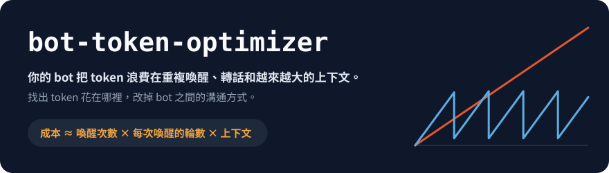
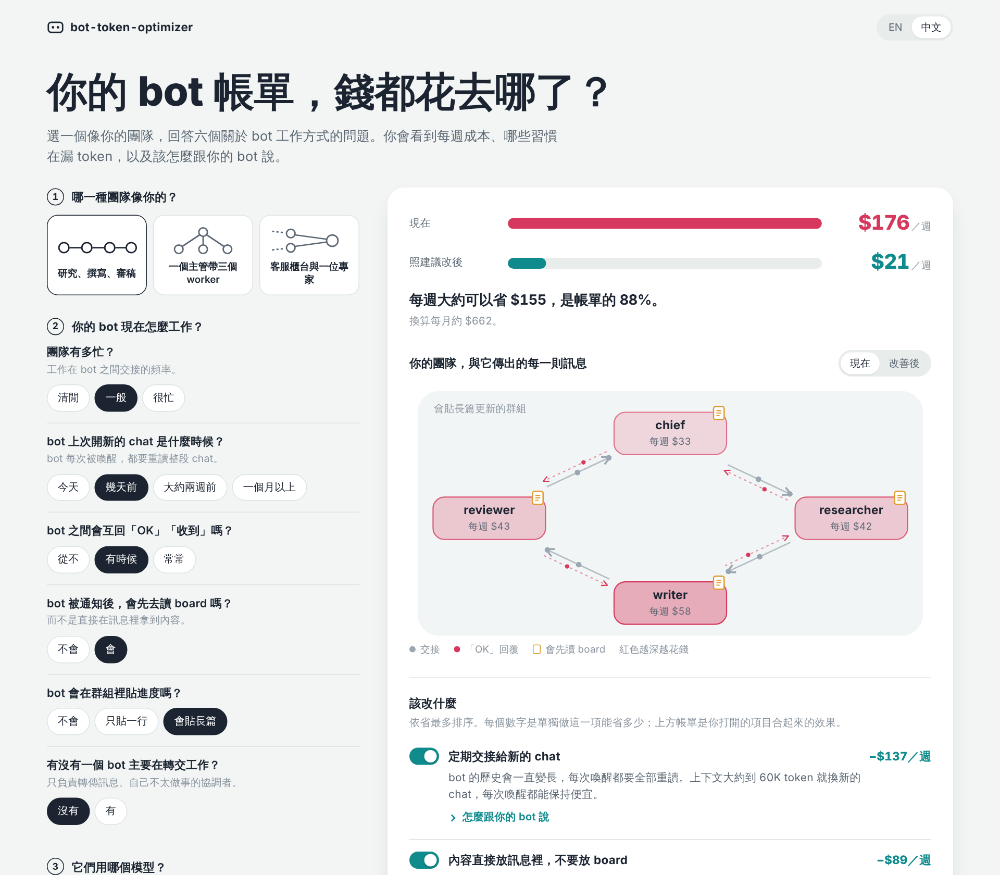
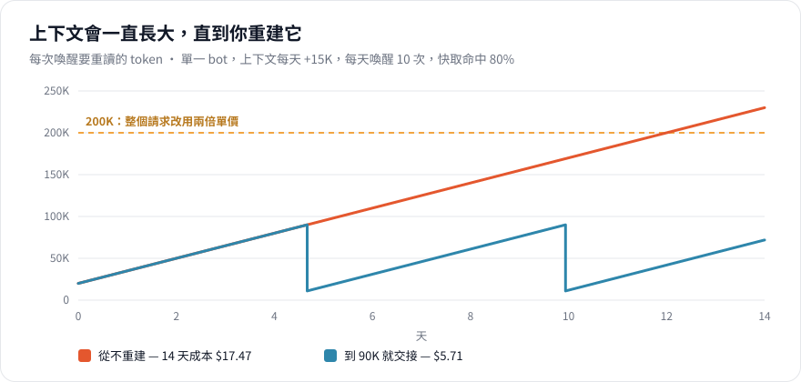
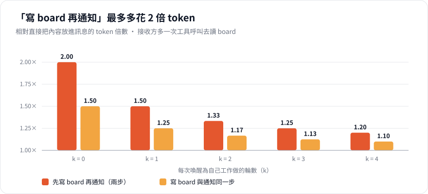
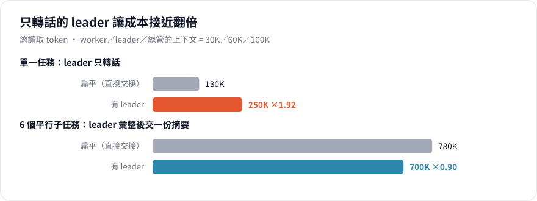
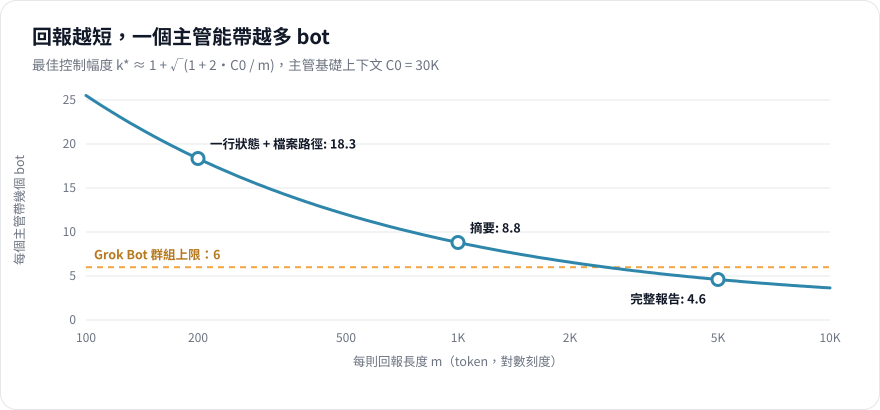
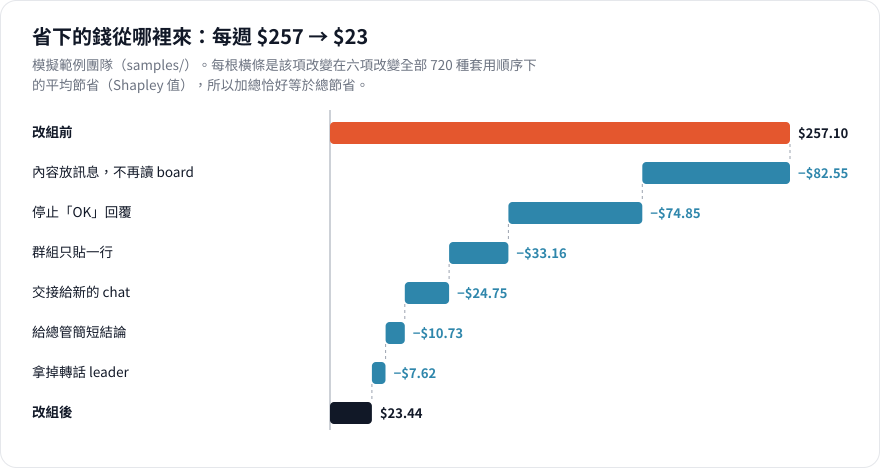
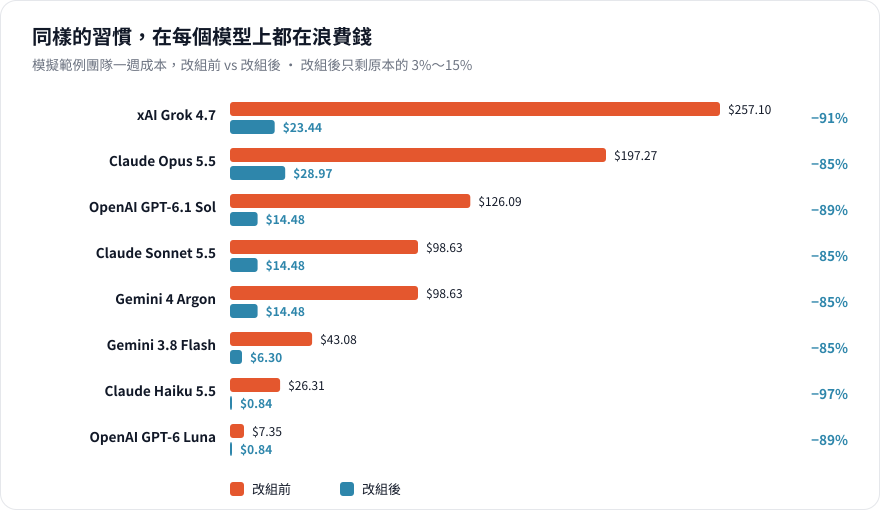
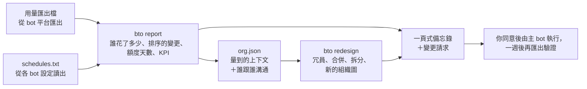
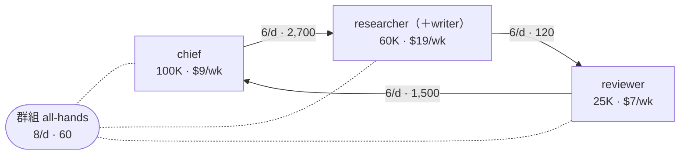

<p align="center">
  
</p>

<p align="center">
  <a href="README.md">English</a> · <b>繁體中文</b>
</p>

<p align="center">
  <a href="https://github.com/EndeavorYen/bot-token-optimizer/actions/workflows/ci.yml"></a>
  
  
  <a href="https://endeavoryen.github.io/bot-token-optimizer/calculator/"></a>
  
</p>

**bot-token-optimizer** 找出一群常駐 bot 把 token 花在哪裡，並告訴你怎麼止血。它讀取你的用量匯出檔，點名每一筆花費背後的 bot（即使匯出檔分不出來），模擬 bot 之間如何互相喚醒，再整理成一份計畫：要改哪個 bot、從什麼改成什麼、能省多少，以及組織應該長什麼樣子。每個數字都來自可以檢查的公式、可以重現的計算，每項變更都整理成可以直接貼給 bot 的請求。

> **一句話看懂**
>
> 1. bot 每次被叫醒，都要把整段對話重讀一遍。
> 2. 所以帳單主要取決於 bot 之間多常互相叫醒、對話已經拉得多長，而不是做了多少事。
> 3. 減少不必要的喚醒（「OK」回覆、轉話、讀 board 的來回），並定期開新的 chat，同樣的工作就能省下大半費用（模擬範例只剩原本的 0.09 倍）。

<p align="center">
  <a href="https://endeavoryen.github.io/bot-token-optimizer/calculator/">
    
  </a>
  <br>
  <sub><a href="https://endeavoryen.github.io/bot-token-optimizer/calculator/"><b>打開網頁計算器</b></a>：不用安裝，和指令列工具使用同一套模型。</sub>
</p>

## 目錄

- [重點總覽](#重點總覽)
- [這適合你嗎？](#這適合你嗎)
- [為什麼 bot 特別燒 token](#為什麼-bot-特別燒-token)
- [成本模型](#成本模型)
- [改完之後長什麼樣子](#改完之後長什麼樣子)
- [運作方式](#運作方式)
- [從用量匯出到計畫](#從用量匯出到計畫)
- [組織改造](#組織改造)
- [快速開始](#快速開始)
- [顧問 bot](#顧問-bot)
- [價格與平台設定](#價格與平台設定)
- [數字如何驗證](#數字如何驗證)
- [常見問題](#常見問題) · [限制](#限制) · [參與貢獻](#參與貢獻) · [引用](#引用)

## 重點總覽

| 習慣 | 對帳單的影響 | 說明 |
| --- | --- | --- |
| 只轉話的 leader | token 是直接交接的 **1.92 倍** | [轉話 leader](#轉話-leader) |
| 「寫到 board，再通知」 | 每則通知最多 **2.00 倍** token | [讀 board 的來回](#讀-board-的來回) |
| 「OK」「收到」回覆 | 每一則都讓接收方**完整重讀一次上下文** | [成本模型](#成本模型) |
| 從不開新的 chat | 14 天成本是「到 90K 就交接」的 **3 倍** | [交接](#交接) |
| 每 30 分鐘輪詢一次、通常什麼都沒有的 bot | 在合成匯出中占全部花費的一半；改成每 2 小時，**每週省 $41–59** | [從匯出到計畫](#從用量匯出到計畫) |
| 鏈中有轉話的 bot、兩個 bot 互相傳草稿 | 公式拿掉一個、合併另一個：加上指令調整後為 **0.51 倍** | [組織改造](#組織改造) |
| 以上全部改掉（範例團隊） | **每週 $257 → $23，0.09 倍** | [改組結果](#改完之後長什麼樣子) |

數字由 [`core/`](core/) 的模型對 [`samples/`](samples/) 範例資料模擬而得，每次修改都會由 CI 重新產生。

## 這適合你嗎？

以下情況有兩項以上符合，你很可能省得下來：

- [ ] 工作量差不多，用量卻一週比一週高。
- [ ] bot 之間會互回「OK」「收到」「謝謝」。
- [ ] 有個 bot 的工作主要是把訊息從一個 bot 轉給另一個。
- [ ] bot 習慣「寫到 board 再通知」，而不是直接把內容傳過去。
- [ ] 有些 bot 已經在同一個 chat 裡跑了好幾週。
- [ ] 有個所有 bot 都在裡面貼進度的群組。
- [ ] 有個主管 bot 要讀每個人的完整報告。
- [ ] 排程 bot 每幾分鐘就醒來一次，大多時候什麼事都沒有。
- [ ] 額度總是在重置前好幾天就用完。

這個專案針對的是**常駐 bot**：長時間運作、會被反覆喚醒、上下文不斷累積。一次性跑完就結束的 agent 任務不會碰到這些成本。

## 為什麼 bot 特別燒 token

常駐 bot **每次被喚醒，都要重讀一次完整上下文**。兩個字的訊息寫起來便宜、收起來昂貴，因為接收方要為它在這個 chat 裡看過的一切付費。所以帳單只由兩件事決定：bot 之間多常互相喚醒，以及每份上下文長到多大。這兩件事，都取決於你的 bot 怎麼分工、怎麼溝通。

<p align="center">
  
</p>

不處理的話，上下文只會變大，每次喚醒都比上一次貴；超過 200K token 後，Grok 會把整個請求改用兩倍單價計費。在這個例子裡，上下文到 90K 就交接給新的 chat，可以把這個 bot 的 14 天成本從 **$17.47 降到 $5.71**。

## 成本模型

對一個由多個 bot $b$ 組成的團隊，模型估算一段期間的成本為

$$
\text{成本} \;\approx\; \sum_{b} \Big(\, W_b \, R_b \, \overline{C}_b \, p_b \;+\; W_b \, O_b \, o \,\Big),
\qquad p_b = h_b\, r + (1 - h_b)
$$

prompt 超過廠商的長上下文門檻時，所有價格再乘上倍數 $\lambda$。

| 符號 | 意義 | 常見數值 |
| --- | --- | --- |
| $W$ | 每天被喚醒的次數（收到的訊息，加上使用者與排程） | 5～20 |
| $R = 1 + k$ | 每次喚醒的呼叫輪數：讀訊息一輪，加上自己工作的 $k$ 輪工具呼叫 | 1～4 |
| $\overline{C}$ | 期間內的平均上下文；收到、讀進、寫出的內容都會讓它變大 | 10K～300K |
| $h$、$r$ | 快取命中率；快取價相對 input 價的比例 | 0.8；0.05～0.25 |
| $O$、$o$ | 每次喚醒的 output（含推理 token）；output 價相對 input 價的倍數 | 300；3～5 |
| $\lambda$ | 長上下文倍數（Grok 在 200K 起 2 倍、Claude Haiku 在 100K 以上 5 倍…） | 1～5 |

以下所有結論都來自三個推論：訊息長度 $m$ 跟 $C$ 相比微不足道，所以縮短訊息幫助不大；每多一次喚醒就多付一整份 $C$；bot 讀進來的內容，之後每次喚醒都還在 $C$ 裡。

### 讀 board 的來回

接收方用工具呼叫去 board 讀內容時，每則通知會多一次完整讀取。設 bot 每次喚醒為自己工作做 $k$ 輪：

$$
\frac{\text{寫 board 的 token}}{\text{直接傳內容的 token}} =
\begin{cases}
\dfrac{k+2}{k+1} & \text{發送方先寫 board 再通知} \\[2ex]
1 + \dfrac{1}{2(k+1)} & \text{寫 board 與通知同一步完成}
\end{cases}
$$

<p align="center"></p>

這個倍數跟訊息長度無關，只看 bot 每次喚醒做多少事，所以很少做其他事的 bot（$k = 0$）要付兩倍。`bto board --k 1`

### 轉話 leader

設 worker、leader、總管的上下文為 $C_w$、$C_\ell$、$C_c$。直接交接一個任務的成本是 $C_w + C_c$，經過轉話 leader 則是 $C_w + 2C_\ell + C_c$。若有 $n$ 個平行子任務，彙整成一份摘要的 leader 成本為 $nC_w + (n+1)C_\ell + C_c$，扁平則是 $nC_w + nC_c$。

<p align="center"></p>

只有在替更昂貴的讀者**壓縮資訊**時，多一層才划算。`bto scenario relay` · `bto scenario aggregate --n 6`

### 控制幅度

主管每收到一則回報就被喚醒一次，回報也會累積在它的上下文裡。設主管基礎上下文為 $C_0$、每則回報 $m$ token，最省錢的「每個主管帶幾個 bot」為

$$
k^{*} \;\approx\; 1 + \sqrt{1 + \frac{2\,C_0}{m}}
$$

<details>
<summary>推導</summary>

主管收齊 $k$ 則回報的成本為 $\sum_{i=1}^{k} (C_0 + i\,m) \approx k\,C_0 + \tfrac{1}{2} m k^2$。管理 $N$ 個 worker 的樹大約需要 $N/(k-1)$ 個主管，所以總成本為

$$
f(k) = \frac{N}{k-1}\Big(k\,C_0 + \tfrac{1}{2}\,m\,k^2\Big)
$$

令 $f'(k) = 0$ 得到 $k^2 - 2k - 2C_0/m = 0$，其正根即為 $k^{*}$。`bto span` 也會用數值方法求解精確的整數問題，並預設加上每個主管接收自己任務時的那次喚醒；不計這次喚醒時，數值最佳解與 $k^{*}$ 相差不超過一個 bot。
</details>

<p align="center"></p>

把完整報告換成一行狀態加檔案路徑，一個主管能帶的 bot 大約變成四倍。平台還會有硬限制（Grok Bot 一個群組最多 6 個）。`bto span --n 12 --c0 30000 --m 1000`

### 交接

把 bot 移到新的 chat，要先讀一次舊上下文寫出 $H$ token 的摘要，再加上新上下文 $C_{\text{new}} = C_{\text{base}} + H$ 的第一次讀取。之後每次喚醒省下 $R\,p\,(C - C_{\text{new}})$，所以交接會在以下次數的喚醒後回本：

$$
n^{*} \;=\; \frac{p\,C + H\,o + C_{\text{new}}}{R\,p\,\big(C - C_{\text{new}}\big)}
$$

以 Grok、基礎設定 8K、摘要 3K、快取命中 80% 計算，$n^{*}$ 在 50K 時是 2.6 次、100K 時 1.7 次、150K 時 1.4 次。只看 token，交接幾乎都在幾次喚醒內回本；真正的限制是摘要中遺失的知識與交接的人力，所以實務上採定期交接。`bto reset --c 150000 --c-base 8000`

## 改完之後長什麼樣子

[`samples/`](samples/) 的範例團隊有轉話 leader、「OK」回覆、來回讀 board、吵雜的群組、給總管的完整報告，以及從不重建的上下文。下圖把總節省拆給六項改變。因為各項改變會互相影響（例如拿掉一個 bot 會改變其他 bot 被群組喚醒的頻率），每根橫條是該項改變在全部 720 種套用順序下的平均節省，也就是它的 Shapley 值，所以加總恰好等於總節省。

<p align="center"></p>

不管用哪個模型，同樣的習慣都在浪費錢。便宜的模型能壓低帳單，卻壓不低被浪費的比例；長上下文加價越陡的模型，從定期交接得到的好處越大（Claude Haiku：−97%）。

<p align="center"></p>

這些是模型對範例資料的模擬結果，不是實際帳單。[顧問示範](docs/advisor-demo.zh-TW.md)有一次完整的諮詢過程；比較結果可以用 `bto compare samples/org_before.txt samples/org_after.txt` 重現。

## 運作方式



分析器把**每個 chat 視為獨立的上下文**，會偵測**你已經做過的交接**（上下文突然變小），避免它們扭曲成長速度，而且 **output 與推理 token** 也一起計價。接著它用你的真實花費校正模型；只有在模型能把實際花費重現到 ±15% 以內時，它對改組方案的預測才值得參考。`bto report` 會把這些整理成一頁式備忘錄：以每週美元表示的結論、標明實測／模型／判斷的排序行動、資料缺口與補法，可直接貼給管理 bot 的那個 bot 的變更請求，以及有檢查日的 KPI（[範例](docs/sample-memo-grok.zh-TW.md)）。匯出檔分不出 bot 時，`--schedules` 會把每個 bot 的排程和喚醒時間對起來，點名是誰。

`bto org` 診斷你描述的團隊，`bto compare` 驗證你自己寫的改組方案。診斷結果長這樣（節錄）：

```text
$ bto org samples/org_before.txt --platform grok-bot --lang zh-TW

## 組織成本評估（7 天）
總成本：約 128,548,279 token 等值（約 $257.10），其中 output 約 $0.89

| Bot        | 目前 C  | 期末 C  | 喚醒/天 | 呼叫輪數/天 | 成本占比 | 等值美元 |
| researcher | 30,000  | 348,430 | 14.0    | 70.0        | 48%      | $124.39  |
| writer     | 30,000  | 324,070 | 14.0    | 56.0        | 35%      | $90.48   |
| chief      | 100,000 | 249,100 | 11.0    | 22.0        | 12%      | $30.75   |
...
最長交接鏈：5 跳（chief → lead → researcher → writer → reviewer → chief）

1. [ack] researcher：writer → researcher 每天 6 則、平均 15 token，疑似「收到/OK」確認訊息。…
2. [ack] writer：reviewer → writer 每天 6 則、平均 15 token，疑似「收到/OK」確認訊息。…
3. [board_tool_read] researcher：被通知後用 tool 讀 board，每次通知多一輪完整上下文。…
```

## 從用量匯出到計畫

`bto report` 讀取匯出檔，寫出一頁式備忘錄：以每週美元表示的結論、誰花了多少、排好序的變更、資料缺口與補法、有檢查日的 KPI，以及一則給管理 bot 的變更請求。以 [`samples/`](samples/) 的合成 Grok 匯出檔、條件「額度 3 天用完，要撐 7 天」為例（[完整備忘錄](docs/sample-memo-grok.zh-TW.md)）：

> 1. 照目前的速度，你的 bot 每週約花 **$158**。額度約 3 天用完；要撐滿 7 天，得降到每週約 **$68**。
> 2. 98% 的花費是在重讀上下文，而不是產出內容。光是 **monitor** 一個 bot 就占全部花費的 50%（排程：every 30m）。
> 3. 建議每週約可省 **$72–120**，每一塊錢只算一次；做完之後額度約可撐 **5.5–12.4 天**。

| 變更 | 每週可省 | 依據 |
| --- | --- | --- |
| monitor：每 30 分鐘 → 每 2 小時（64% 的檢查無事可做） | $41–59 | 實測 |
| 交接到新 chat：monitor 和 digest 到 4 萬 token、其他到 10 萬 | $25–50 | 模型 |
| heartbeat：每 1 小時 → 每 3 小時 | $2 | 實測 |

每個數字是怎麼來的：

- **點名 bot。** Grok 的匯出檔沒有 bot 編號，只能依模型分組。但排程 bot 會在固定時間醒來：在排程觸發前 60 秒到觸發後 5 分鐘內開始的喚醒，就歸給該排程，距離最近者優先，每次觸發只對一個喚醒。於是每個 bot 都有自己的花費、每次喚醒成本、上下文，以及無事可做的比例（只呼叫一次、輸出 ≤ 80 token）。剩下的是非排程流量。
- **減少排程檢查。** 無事可做比例為 $u$ 時，新間隔 = 舊間隔 $\div (1-u)$，再取整到常用的間隔；省量 = 實測每次喚醒成本 × 減少的喚醒次數。
- **交接門檻。** 對每個上下文、每個從 4 萬到 15 萬的門檻 $T$，設新 chat 從 $C_f$ 開始、每週成長 $G$ token：

$$
n_T = \frac{G}{T - C_f}, \qquad \text{省量}_T = W R\,p\,\Big(C - \frac{C_f + T}{2}\Big) - n_T \cdot \text{重建成本}
$$

  每個上下文會在每週交接 $n_T \le 7$ 次（可調整）的前提下，選最省的 $T$。怎麼設都超過上限的上下文，會列成一個附金額的決定，絕不默默放棄。
- **額度天數。** 每週花費 $S$、額度可撐 $d$ 天時，額度約等於 $Q = S\,d/7$。要撐 $d^{*}$ 天，需要 $S \le 7Q/d^{*}$；省下 $\Delta S$ 之後可撐 $7Q/(S - \Delta S)$ 天。`bto quota` 可以對任何數字做同樣的計算。
- **每一塊錢只算一次。** 交接用改完排程後剩下的喚醒來計價；無事可做的檢查不會再被當成確認訊息重算；快取的省量會隨上下文縮小而減少。實測、模型、判斷的數字都會標明；判斷的區間不計入總數。

## 組織改造

`bto redesign org.txt` 替同一批 bot 尋找更省的組織。它一次試一項變更，保留最省的那一項，直到沒有任何變更能省下總成本 2% 以上：

| 變更 | 什麼時候會試 | 公式比較什麼 |
| --- | --- | --- |
| 取消確認訊息、內容放進訊息、群組只貼一行狀態 | 一律 | 省掉的喚醒與 board 讀取 |
| **拿掉**某個 bot | 只有一個上游、一個下游，沒有自己的工具工作或喚醒，往下傳的和收到的差不多 | 不再有人讀它的上下文，交接改成直接 |
| **合併**兩個 bot | 兩者互相交接，或同一個主管 | 少一份上下文、少了交接造成的喚醒，對上每次喚醒都要讀的較大上下文（兩份基礎設定都保留、每天的工作量不變） |
| **拆開**某個 bot | 它服務三個以上的來源 | 兩個較小的上下文，對上每天兩次互換簡短摘要 |
| **加入 leader** | 主管的直屬回報超過控制幅度 | 用 $k^{*}$ 決定每組大小，每個 leader 每一輪只交一份摘要 |

比較是公平的：看四週、所有結構都用同一個交接策略，而且每個會循環交接的上下文都從新 chat 開始。標記 `keep` 的 bot 不會被拿掉或併入別人。以範例團隊為例（[完整輸出](docs/sample-redesign.zh-TW.md)），保留 chief 和 reviewer：指令調整讓每週從 $62.87 降到 $36.39；再拿掉只轉話的 **lead**、把 **writer** 併入 **researcher**，降到 **$32.33（0.51 倍）**：



公式看不出兩份工作適不適合放在一起，所以每項合併都附檢查提醒：需要相同的工具與權限，而且彼此不互相審查。顧問會先逐項把關才提出。`bto report --org-out` 會依量到的上下文與具名 bot 寫出骨架，可以從它開始。因為每個方案都在交接策略下比較，改組的基準會比 `bto org`（假設上下文從不重置）低。

## 快速開始

```bash
pip install git+https://github.com/EndeavorYen/bot-token-optimizer
bto --help
```

不需要任何相依套件。也可以 clone repo 後，用 `python3 core/cli.py` 取代 `bto`。

| 想做的事 | 指令 |
| --- | --- |
| 一頁式備忘錄：錢花在哪、先改什麼 | `bto report usage.csv --platform grok-bot --tz +08:00 --quota-days 3` |
| 依排程點名分組裡的 bot | `bto report usage.csv --schedules schedules.txt --tz +08:00` |
| 預算與額度天數（任何數字都可以算） | `bto quota --week-usd 2536 --days-now 3 --save 560 630` |
| 每日花費與最近的變化 | `bto trend usage.csv --tz +08:00` |
| 逐上下文明細 | `bto analyze usage.csv --platform grok-bot` |
| 量到的上下文與具名 bot 的組織骨架 | `bto report usage.csv --schedules schedules.txt --org-out org.json` |
| 用問答描述你的團隊 | `bto init` |
| 診斷團隊 | `bto org org.txt --platform grok-bot` |
| 誰是冗員、該合併或拆開什麼、最佳組織圖 | `bto redesign org.txt --keep chief --out after.txt` |
| 比較你自己寫的改組方案 | `bto compare org.txt org_redesign.txt` |
| 讀 board 的來回值不值得？ | `bto board --k 1` |
| 一個主管該帶幾個？ | `bto span --n 12 --c0 30000 --m 1000` |
| 該開新的 chat 了嗎？ | `bto reset --c 150000 --c-base 8000` |
| 列出價格與平台設定 | `bto presets` |

報告支援英文與繁體中文（`--lang en|zh-TW`；預設依 `BTO_LANG`，再依系統語系）。一個團隊只要幾行 `org.txt`：

```text
settings horizon=7 soft_cap=120k handover_at=60k
bot chief      100k base=8k wakes=3 rounds=1 keep
bot researcher 30k  rounds=3 board
bot writer     30k  rounds=2
chief -> researcher : 6/day 800
researcher -> writer : 6/day 1.5k
writer -> researcher : 6/day 15        # 「收到」回覆
group team : chief researcher writer : 10/day 900
```

`keep` 標記不能被拿掉或併入別人的 bot；`handover_at` 讓團隊在某個交接策略下評估。排程檔一樣簡短：`monitor every 30m`、`digest at 09:00,18:00`、`sync cron */15 9-18 * * 1-5`。寫錯時會一次列出所有問題並標明行號。CSV 欄位會自動辨識（`timestamp`、`bot_name`、`chat_id`、`input_tokens`、`cached_input_tokens`、`output_tokens`、`reasoning_tokens`、`cost_usd` 等）；其他名稱用 `--map time=日期 --map bot=Bot` 指定。

## 顧問 bot

把這個 repo 變成 bot 平台裡隨叫隨到的成本顧問。它會界定你的目標，然後自己調查（直接讀各 bot 的排程、指令和群組，而不是反過來問你），診斷後給出具體變更：哪個 bot、哪個設定、從什麼改成什麼、省多少、多有把握，並整理成一則管理 bot 能直接執行的請求；最後列出只有你能做的決定，以及有檢查日的 KPI。所有數字都來自經過測試的工具；資料不完美時它仍會回答，並說明把握有多大、怎麼補資料。請看[諮詢範例](docs/advisor-demo.zh-TW.md)。

| 什麼時候叫它 | 你會得到 |
| --- | --- |
| 用量消耗太快 | 它先自己查各 bot 的排程與規則，再給你點名最花錢 bot 的三句話結論、附每週金額的具體變更、給主 bot 的變更請求，以及[一頁式備忘錄](docs/sample-memo-grok.zh-TW.md) |
| 想要改組 | 誰是冗員、哪些 bot 該合併或拆開、目前與建議的組織圖及每項變更省多少（[範例](docs/sample-redesign.zh-TW.md)），以及變更請求 |
| 想問「如果…會怎樣」 | 先給答案，再給對應工具算出的數字：board、leader、控制幅度、交接 |

Grok Bot 的設定方式：[手把手教學](adapters/grok-bot/SETUP.zh-TW.md)（每一句要對既有 bot 說的話都寫好了），以及 [adapter 說明](adapters/grok-bot/README.zh-TW.md)。

## 價格與平台設定

價格是 2026-10-20 對照各家官方價目頁查詢的，依賴美元數字前請再確認。

| 設定名稱 | 每百萬 token：input／快取／output | 長上下文計價 |
| --- | --- | --- |
| `grok-4.7`（預設） | $2.00／$0.50／$6.00 | ≥ 200K：2 倍 |
| `gpt-6.1-sol` | $2.00／$0.10／$10.00 | > 272K：input 2 倍、output 1.5 倍 |
| `gpt-6-luna` | $0.10／$0.01／$0.50 | > 272K：input 2 倍、output 1.5 倍 |
| `claude-opus-5-5` | $4.00／$0.20／$20.00 | 無 |
| `claude-sonnet-5-5` | $2.00／$0.10／$10.00 | 無 |
| `claude-haiku-5-5` | $0.10／$0.01／$0.50 | > 100K：5 倍 |
| `gemini-4-argon` | $2.00／$0.10／$10.00 | 無（2026-12-01 起價格加倍） |
| `gemini-3.8-flash` | $0.75／$0.075／$3.75 | 無（2027-01-01 起價格加倍） |

平台設定：`grok-bot`（群組上限 6）和 `generic`（控制幅度上限 8）。用 `--pricing <設定名稱>` 可以讓任何平台搭配任何模型。

## 數字如何驗證

| 檢查 | 保證什麼 |
| --- | --- |
| 105 項單元測試 | README 與指引中的每條公式、每張表，都能從手算值重現；顧問建立教學裡引用的標準答案也由測試檢查 |
| 1,083 項一致性檢查 | 網頁計算器的結果與 Python 模型完全一致；在 192 種回答組合下，計算器的任何改善都不會讓帳單變高 |
| CI 重新產生圖表與範例 | 每次推送都重新產生所有圖表、範例備忘錄與範例改組，任何一個過期時 CI 會失敗 |
| 校正 | `bto analyze` 重現合成範例實際花費的誤差為 2.1%；用在你的資料上時會回報誤差，讓你自行判斷 |
| Shapley 歸因 | 節省拆解的加總恰好等於總節省，而且與改變的套用順序無關 |

## 常見問題

<details>
<summary><b>有 prompt caching，這些問題不就沒了？</b></summary>

沒有。快取降低的是每次重讀的單價（依廠商約為 input 價的 5%～25%），但重讀次數仍然是喚醒次數乘以上下文大小，而且很多廠商在 prompt 超過長上下文門檻後會加價。模型已經把快取命中率算進去。
</details>

<details>
<summary><b>我的平台會自動摘要或裁切上下文。</b></summary>

那麼實際成長會比模型假設的慢。分析器是從你的資料量測成長速度，所以校正結果會反映出來；關於喚醒次數與轉話的建議依然適用。
</details>

<details>
<summary><b>我的平台是訂閱制，不是按 token 計費。</b></summary>

那麼美元數字代表「等值成本」，仍然能正確排出方案的優劣；而且 token 用量通常就是決定你額度或速率限制的因素。
</details>

<details>
<summary><b>準確度如何？</b></summary>

它提供的是方向和量級。在合成範例上，模型重現實際花費的誤差約 2%，但這份資料本身就是依照模型假設產生的。請用你自己的資料執行 `bto analyze`，看看校正誤差。
</details>

<details>
<summary><b>我的匯出檔分不出是哪個 bot。</b></summary>

Grok Bot 很常見，因為 Automation ID 常是空的。把每個 bot 的排程寫進排程檔，執行 `bto report --schedules`：排程造成的喚醒會依時間對回各自的 bot，剩下的列為非排程流量（你的訊息與 bot 之間的通知）。顧問 bot 會自己從各 bot 的設定讀出排程。
</details>

<details>
<summary><b>它會修改或刪除我的 bot 嗎？</b></summary>

不會。工具只做計算。顧問 bot 會讀取其他 bot 的設定，但從不修改：它寫出變更請求，由管理其他 bot 的那個 bot 在你同意後執行。要拿掉的 bot 會先暫停，不會刪除。
</details>

<details>
<summary><b>我的 CSV 會被傳到別的地方嗎？</b></summary>

不會。所有計算都在本機執行，沒有任何網路連線；網頁計算器也完全在你的瀏覽器裡運算。
</details>

## 限制

模型提供的是方向和量級，不是精確帳單。它假設每輪呼叫都重讀完整上下文，並把兩次交接之間的成長視為線性。它沒有把長上下文與交接造成的品質損失算進去，也沒有計入部分廠商額外收取的快取寫入費用。目前的校正只用過合成資料。Grok Bot 的 usage-events 匯出檔可以直接讀，但沒有 chat 編號，Automation ID 也常是空的，所以會依模型分組；排程可以點名排程 bot，非排程流量則仍是混合的，它的成長（以及交接次數）是偏低的估計。對上次數和巧合差不多的排程會被標示。組織改造的搜尋是逐步貪婪法，而且只看成本：兩份工作能不能放進同一個 bot，要由人決定。詳見[指引](docs/guide.zh-TW.md#限制與參考文獻)。

## Repo 結構

```
core/                       bto 套件：成本模型、CSV 分析、排程比對、建議與備忘錄、組織改造、org.txt 解析、指令列工具
core/pricing/               價格設定（8 個模型）
core/platforms/             平台設定（grok-bot、generic）
adapters/grok-bot/          手把手建立教學、adapter 說明與顧問工作手冊（中文 / English）
docs/guide.zh-TW.md         完整指引：模型、公式、架構決策、反模式
docs/advisor-demo.zh-TW.md  一次諮詢的完整範例（實際輸出）
docs/sample-memo*.zh-TW.md  `bto report` 產出的一頁式備忘錄（由 make_memos.py 產生）
docs/sample-redesign.zh-TW.md  `bto redesign` 對範例團隊的改組建議
docs/make_memos.py          重新產生範例備忘錄與範例改組（CI 會檢查）
docs/calculator/            網頁計算器（GitHub Pages），與 Python 模型交叉驗證
docs/images/                圖表，由 make_figures.py 依模型產生
samples/                    範例團隊、示範團隊、合成的 usage CSV、Grok 匯出檔產生器與其排程檔
tests/                      單元測試與計算器一致性檢查
```

## 參與貢獻

目前最有幫助的是真實資料：你的平台 usage 匯出檔的欄位名稱，以及你得到的校正誤差。詳見 [CONTRIBUTING.md](CONTRIBUTING.md#中文)。

## 引用

如果這個專案對你有幫助，歡迎引用（GitHub 的「Cite this repository」按鈕會讀取 [`CITATION.cff`](CITATION.cff)）：

```bibtex
@software{bot_token_optimizer,
  author = {EndeavorYen},
  title  = {bot-token-optimizer: token cost modeling for teams of persistent bots},
  year   = {2026},
  url    = {https://github.com/EndeavorYen/bot-token-optimizer}
}
```

## 授權

[MIT](LICENSE)
