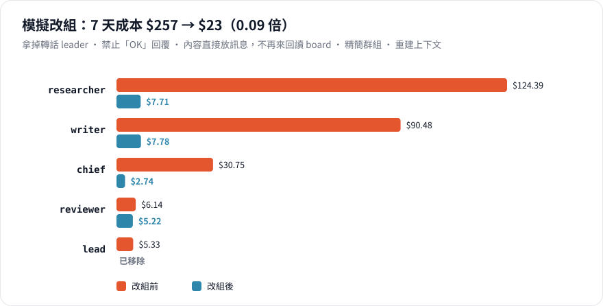
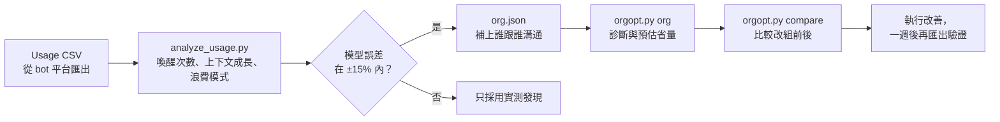

<p align="center">
  
</p>

<p align="center">
  <a href="README.md">English</a> · <b>繁體中文</b>
</p>

<p align="center">
  
  
  
  
</p>

**bot 的用量越來越兇，卻不知道錢花到哪裡？** 大部分 token 不是花在工作本身，而是花在 bot 互相喚醒、轉傳訊息，以及反覆重讀一份越來越大的上下文。這個專案幫你找出 token 花在哪裡，並告訴你怎麼調整 bot 之間的分工和溝通，讓它們不再白白燒錢。

- 📊 **分析**：讀進 usage CSV，算出每個 bot 的喚醒次數、上下文成長、浪費的喚醒，以及何時會碰到長上下文計價門檻。
- 🧮 **模擬**：改組之前先算，比較不同方案的成本。公式都經過測試，不是憑感覺。
- 🤖 **顧問 bot**：用量暴增時丟一份 CSV 給它，拿到最省的三項改善。

---

## 為什麼 bot 特別燒 token

bot 是常駐的。**它每次被喚醒，都要重讀一次完整上下文**，所以帳單遵循一條規則：

```
成本 ≈ 喚醒次數 × 每次喚醒的呼叫輪數 × 上下文大小
```

縮短訊息幫助不大，因為一則訊息和它觸發重讀的上下文相比微不足道。真正有影響的只有兩件事：**bot 之間多常互相喚醒**，以及**每個 bot 的上下文長到多大**。這兩件事，都取決於你的 bot 怎麼分工、怎麼溝通。

<p align="center">
  
</p>

不處理的話，bot 的上下文只會變大，每次喚醒都更貴；超過 200K token 後，Grok 會把整個請求改用兩倍單價計費。上下文到 90K 就交接給新的 chat，這個 bot 的 14 天成本降到約**三分之一**。

## 四個讓帳單悄悄翻倍的習慣

### 1. 只轉話的 leader

<p align="center">
  
</p>

每多一層，每個任務就多兩次喚醒：派工下去一次，回報上來一次。只轉話的 leader 成本是直接交接的 **1.92 倍**。leader 只有在**壓縮資訊**時才值得存在：收六份報告，往上只交一份摘要。這時整個團隊反而比扁平更便宜（0.90 倍），因為最貴的總管只被叫醒一次，而不是六次。

### 2. 「寫到 board，再通知對方」

<p align="center">
  
</p>

看起來很省：用一則短通知代替長訊息。但接收方處理這則通知時，還是要重讀完整上下文；去讀完 board 之後，又再重讀一次。而讀進來的內容，照樣會留在它的上下文裡。對很少做其他事的 bot（k = 0）來說，這等於 **2 倍 token**。小內容直接放進訊息；大內容在通知中寫清楚要讀哪一段。

### 3. 「OK」「收到」「謝謝」

一則只有兩個 token 的確認訊息，會叫醒接收方，而接收方要付出讀**整份上下文**的代價才能看到它。在 bot 的指令中禁止純確認訊息，並把通知合併。

### 4. 一個主管讀每個人的完整報告

<p align="center">
  
</p>

每則回報都會叫醒主管，也都會留在它的上下文裡。一個主管最適合帶幾個 bot，大約是 **k\* ≈ 1 + √(1 + 2·C0 / m)**：把完整報告改成一行狀態加檔案路徑，一個主管就能帶更多 bot，層級也更少。平台還會有硬限制，例如 Grok Bot 一個群組最多 6 個 bot。

## 改完之後長什麼樣子

<p align="center">
  
</p>

[`samples/`](samples/) 裡的範例團隊有轉話 leader、「OK」回覆、來回讀 board、吵雜的群組，以及從不重建的上下文。改掉這五件事後，模擬的一週成本從 **$256 降到 $25（0.10 倍）**。你可以自己跑跑看：

```bash
python3 core/orgopt.py compare samples/org_before.json samples/org_after.json
```

## 運作方式



分析器會先用你的真實資料校正模型。模型能把實際花費重現到 ±15% 以內，它對改組方案的預測才值得參考。

## 快速開始

不需要安裝任何套件，只要 Python 3。

```bash
git clone https://github.com/EndeavorYen/bot-token-optimizer
cd bot-token-optimizer
python3 -m unittest discover -s tests          # 32 項測試

# token 花到哪裡去了？
python3 core/analyze_usage.py usage.csv --platform adapters/grok-bot/platform.json --org-out org.json

# 診斷團隊（先在 links 補上誰傳什麼給誰）
python3 core/orgopt.py --platform adapters/grok-bot/platform.json org org.json

# 常見問題
python3 core/orgopt.py board --k 1                      # 寫 board 再通知值不值得？
python3 core/orgopt.py span --n 12 --c0 30000 --m 1000  # 一個主管該帶幾個？
python3 core/orgopt.py reset --c 150000 --c-base 8000   # 該交接給新的 chat 了嗎？
```

欄位名稱會自動辨識（`timestamp`、`bot_name`、`input_tokens`、`cached_input_tokens`、`output_tokens` 等）。對不上時用 `--map`，例如 `--map time=日期 --map bot=Bot --map input=輸入token`。

## 顧問 bot

把這個 repo 變成 bot 平台裡隨叫隨到的顧問。用量暴增或準備改組時呼叫它；它會一次問完需要的資訊，所有數字都只由經過測試的腳本產生。

| 什麼時候叫它 | 它會做什麼 |
| --- | --- |
| 用量消耗太快 | 分析 CSV、校正模型、找出浪費和最貴的 bot，給前三項改善 |
| 想要改組 | 建立現況與 1～2 個方案，比較總成本、熱點與層數 |
| 想問「如果…會怎樣」 | 用對應的公式回答：board、leader、控制幅度、重建 |

Grok Bot 的設定方式：[`adapters/grok-bot/`](adapters/grok-bot/README.zh-TW.md)。

## Repo 結構

```
core/orgopt.py            成本模型：board / scenario / span / reset / org / compare / cost
core/analyze_usage.py     usage CSV 分析與模型校正
pricing/                  價格設定（grok-4.7）
adapters/grok-bot/        平台限制與顧問 bot 指令（中文 / English）
docs/guide.zh-TW.md       完整指引：模型、公式、架構決策、反模式
docs/images/              圖表，由 make_figures.py 依模型產生
samples/                  範例團隊（改組前／後）與合成的 usage CSV
tests/                    32 項測試
```

## 其他 bot 平台

模型本身不綁平台，Grok Bot 是第一個 adapter。要支援你的平台，新增 `adapters/<平台>/platform.json`：

```json
{"name": "My Bot Platform", "pricing": "../../pricing/<preset>.json", "span_cap": 8}
```

需要的話加上價格設定，並依平台限制調整顧問 bot 的指令。歡迎發 PR。

## 限制

模型提供的是方向和量級，不是精確帳單。它假設每輪呼叫都重讀完整上下文、把上下文成長視為線性，也沒有把長上下文和交接造成的品質損失算進去。Grok Bot usage CSV 的欄位名稱尚未用真實匯出檔驗證。詳見[指引](docs/guide.zh-TW.md#限制與參考文獻)。

## 延伸閱讀

- 📘 [完整指引（中文）](docs/guide.zh-TW.md) · [Full guide (English)](docs/guide.en.md)
- 重新產生圖表：`python3 docs/images/make_figures.py`

## 授權

[MIT](LICENSE)
