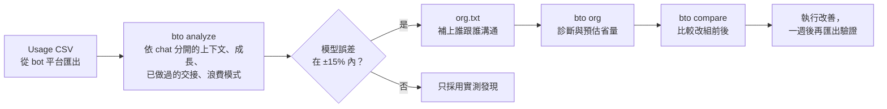

<p align="center">
  
</p>

<p align="center">
  <a href="README.md">English</a> · <b>繁體中文</b>
</p>

<p align="center">
  <a href="https://github.com/EndeavorYen/bot-token-optimizer/actions/workflows/ci.yml"></a>
  
  <a href="https://endeavoryen.github.io/bot-token-optimizer/calculator/"></a>
  
</p>

**bot 的用量越來越兇，卻不知道錢花到哪裡？** 大部分 token 不是花在工作本身，而是花在 bot 互相喚醒、轉傳訊息，以及反覆重讀一份越來越大的上下文。這個專案幫你找出 token 花在哪裡，並告訴你怎麼調整 bot 之間的分工和溝通，讓它們不再白白燒錢。

- 📊 **分析**：讀進 usage CSV，依 bot、依 chat 算出喚醒次數、上下文成長、浪費的呼叫，以及何時會碰到長上下文計價門檻。
- 🧮 **模擬**：用幾行文字描述你的團隊，改組之前先比較不同方案的成本。
- 🤖 **顧問 bot**：用量暴增時丟一份 CSV 給它，拿到最省的三項改善。
- 🌐 **[網頁計算器](https://endeavoryen.github.io/bot-token-optimizer/calculator/)**：不用安裝，公式完全相同。

## 這適合你嗎？

以下情況有兩項以上符合，你很可能省得下來：

- [ ] 工作量差不多，用量卻一週比一週高。
- [ ] bot 之間會互回「OK」「收到」「謝謝」。
- [ ] 有個 bot 的工作主要是把訊息從一個 bot 轉給另一個。
- [ ] bot 習慣「寫到 board 再通知」，而不是直接把內容傳過去。
- [ ] 有些 bot 已經在同一個 chat 裡跑了好幾週。
- [ ] 有個所有 bot 都在裡面貼進度的群組。
- [ ] 有個主管 bot 要讀每個人的完整報告。

---

## 為什麼 bot 特別燒 token

bot 是常駐的。**它每次被喚醒，都要重讀一次完整上下文**，所以帳單遵循一條規則：

```
成本 ≈ 喚醒次數 × 每次喚醒的呼叫輪數 × 上下文大小   （再加上它寫出的 output）
```

縮短訊息幫助不大，因為一則訊息和它觸發重讀的上下文相比微不足道。真正有影響的只有兩件事：**bot 之間多常互相喚醒**，以及**每個 bot 的上下文長到多大**。這兩件事，都取決於你的 bot 怎麼分工、怎麼溝通。

<p align="center">
  
</p>

不處理的話，bot 的上下文只會變大，每次喚醒都更貴；超過 200K token 後，Grok 會把整個請求改用兩倍單價計費。上下文到 90K 就交接給新的 chat，這個 bot 的 14 天成本降到約**三分之一**。

## 四個讓帳單悄悄翻倍的習慣

### 1. 只轉話的 leader

<p align="center">
  
</p>

每多一層，每個任務就多兩次喚醒：派工下去一次，回報上來一次。只轉話的 leader 成本是直接交接的 **1.92 倍**。leader 只有在**壓縮資訊**時才值得存在：收六份報告，往上只交一份摘要。這時整個團隊反而比扁平更便宜（0.90 倍），因為最貴的總管只被叫醒一次，而不是六次。

### 2. 「寫到 board，再通知對方」

<p align="center">
  
</p>

看起來很省：用一則短通知代替長訊息。但接收方處理這則通知時，還是要重讀完整上下文；去讀完 board 之後，又再重讀一次。而讀進來的內容，照樣會留在它的上下文裡。對很少做其他事的 bot（k = 0）來說，這等於 **2 倍 token**。小內容直接放進訊息；大內容在通知中寫清楚要讀哪一段。

### 3. 「OK」「收到」「謝謝」

一則只有兩個 token 的確認訊息，會叫醒接收方，而接收方要付出讀**整份上下文**的代價才能看到它。在 bot 的指令中禁止純確認訊息，並把通知合併。

### 4. 一個主管讀每個人的完整報告

<p align="center">
  
</p>

每則回報都會叫醒主管，也都會留在它的上下文裡。一個主管最適合帶幾個 bot，大約是 **k\* ≈ 1 + √(1 + 2·C0 / m)**：把完整報告改成一行狀態加檔案路徑，一個主管就能帶更多 bot，層級也更少。平台還會有硬限制，例如 Grok Bot 一個群組最多 6 個 bot。

## 改完之後長什麼樣子

<p align="center">
  
</p>

[`samples/`](samples/) 裡的範例團隊有轉話 leader、「OK」回覆、來回讀 board、吵雜的群組，以及從不重建的上下文。改掉這五件事後，**模擬**的一週成本從 **$257 降到 $25（0.10 倍）**。這是模型對範例資料的計算結果，不是實際帳單；完整的諮詢過程請看[顧問示範](docs/advisor-demo.zh-TW.md)，也可以自己跑跑看：

```bash
bto compare samples/org_before.txt samples/org_after.txt --lang zh-TW
```

## 運作方式



分析器把**每個 chat 視為獨立的上下文**，會偵測**你已經做過的交接**（上下文突然變小），避免它們扭曲成長速度，而且 **output 與推理 token** 也一起計價。接著它用你的真實花費校正模型：模型能把實際花費重現到 ±15% 以內，它對改組方案的預測才值得參考。

## 快速開始

```bash
pip install git+https://github.com/EndeavorYen/bot-token-optimizer
bto --help
```

不需要任何相依套件。也可以 clone repo 後，用 `python3 core/cli.py` 取代 `bto`。

```bash
# token 花到哪裡去了？
bto analyze usage.csv --platform grok-bot --org-out org.json --lang zh-TW

# 回答幾個問題來描述你的團隊（會寫出 org.txt 和 org.json）
bto init --lang zh-TW

# 診斷團隊、比較改組方案
bto org org.txt --platform grok-bot --lang zh-TW
bto compare org.txt org_redesign.txt --lang zh-TW

# 常見問題
bto board --k 1                        # 寫 board 再通知值不值得？
bto span --n 12 --c0 30000 --m 1000    # 一個主管該帶幾個？
bto reset --c 150000 --c-base 8000     # 該交接給新的 chat 了嗎？
```

報告支援英文和繁體中文：`--lang en|zh-TW`。也可以設定環境變數 `BTO_LANG=zh-TW`，或讓它依系統語系自動判斷。

一個團隊只要幾行 `org.txt`：

```text
settings horizon=7 soft_cap=120k
bot chief      100k base=8k wakes=3 rounds=1
bot researcher 30k  rounds=3 board
bot writer     30k  rounds=2
chief -> researcher : 6/day 800
researcher -> writer : 6/day 1.5k
writer -> researcher : 6/day 15        # 「收到」回覆
group team : chief researcher writer : 10/day 900
```

寫錯時會標出行號，並一次列出所有問題（不存在的 bot 名稱、欄位名稱打錯、負數等）。

CSV 欄位會自動辨識（`timestamp`、`bot_name`、`chat_id`、`input_tokens`、`cached_input_tokens`、`output_tokens`、`reasoning_tokens`、`cost_usd` 等）。對不上時用 `--map`，例如 `--map time=日期 --map bot=Bot --map input=輸入token`。

## 顧問 bot

把這個 repo 變成 bot 平台裡隨叫隨到的顧問。用量暴增或準備改組時呼叫它；它會一次問完需要的資訊，所有數字都只由經過測試的腳本產生。請看[完整的諮詢範例](docs/advisor-demo.zh-TW.md)。

| 什麼時候叫它 | 它會做什麼 |
| --- | --- |
| 用量消耗太快 | 分析 CSV、校正模型、找出浪費和最貴的 bot，給前三項改善 |
| 想要改組 | 建立現況與 1～2 個方案，比較總成本、熱點與層數 |
| 想問「如果…會怎樣」 | 用對應的公式回答：board、leader、控制幅度、重建 |

Grok Bot 的設定方式：[`adapters/grok-bot/`](adapters/grok-bot/README.zh-TW.md)。

## 價格與平台設定

用 `bto presets` 列出全部設定。價格是 2026-10-20 從各家官方價目頁查詢的，使用前請再確認。

| 設定名稱 | 每百萬 token：input／快取／output | 長上下文計價 |
| --- | --- | --- |
| `grok-4.7`（預設） | $2.00／$0.50／$6.00 | ≥ 200K：2 倍 |
| `gpt-6.1-sol` | $2.00／$0.10／$10.00 | > 272K：input 2 倍、output 1.5 倍 |
| `gpt-6-luna` | $0.10／$0.01／$0.50 | > 272K：input 2 倍、output 1.5 倍 |
| `claude-opus-5-5` | $4.00／$0.20／$20.00 | 無 |
| `claude-sonnet-5-5` | $2.00／$0.10／$10.00 | 無 |
| `claude-haiku-5-5` | $0.10／$0.01／$0.50 | > 100K：5 倍 |
| `gemini-4-argon` | $2.00／$0.10／$10.00 | 無（2026-12-01 起價格加倍） |
| `gemini-3.8-flash` | $0.75／$0.075／$3.75 | 無（2027-01-01 起價格加倍） |

平台設定：`grok-bot`（群組上限 6）和 `generic`（控制幅度上限 8）。用 `--pricing <設定名稱>` 可以讓任何平台搭配任何模型。

## 常見問題

**有 prompt caching，這些問題不就沒了？** 沒有。快取降低的是每次重讀的單價（依廠商約為 input 價的 5%～25%），但重讀的次數仍然是喚醒次數乘以上下文大小，而且很多廠商在 prompt 超過長上下文門檻後會加價。模型已經把快取命中率算進去。

**我的平台會自動摘要或裁切上下文。** 那麼實際成長會比模型假設的慢。分析器是從你的資料量測成長速度，所以校正結果會反映出來；關於喚醒次數和轉話的建議依然適用。

**我的平台是訂閱制，不是按 token 計費。** 那麼美元數字代表「等值成本」，仍然能正確比較方案的優劣；而且 token 用量通常就是決定你額度或速率限制的因素。

**這是講一般的 agent 嗎？** 這個專案針對的是**常駐 bot**：長時間運作、會被反覆喚醒、上下文會不斷累積。一次性跑完就結束的 agent 任務不會碰到這些成本。

**準確度如何？** 它提供的是方向和量級。在合成範例上，模型重現實際花費的誤差約 2%，但這份資料本身就是依照模型假設產生的；請用你自己的資料跑 `bto analyze`，看看校正誤差。

**我的 CSV 會被傳到別的地方嗎？** 不會。所有計算都在本機執行，沒有任何網路連線。

## Repo 結構

```
core/                     bto 套件：成本模型、CSV 分析、org.txt 解析、指令列工具
core/pricing/             價格設定（8 個模型）
core/platforms/           平台設定（grok-bot、generic）
adapters/grok-bot/        顧問 bot 的設定方式與指令（中文 / English）
docs/guide.zh-TW.md       完整指引：模型、公式、架構決策、反模式
docs/advisor-demo.zh-TW.md 一次諮詢的完整範例（實際輸出）
docs/calculator/          網頁計算器（GitHub Pages），與 Python 模型交叉驗證
docs/images/              圖表，由 make_figures.py 依模型產生
samples/                  範例團隊、示範團隊與合成的 usage CSV
tests/                    單元測試，以及計算器一致性檢查
```

## 參與貢獻

目前最有幫助的是真實資料：你的平台 usage 匯出檔的欄位名稱，以及你得到的校正誤差。詳見 [CONTRIBUTING.md](CONTRIBUTING.md#中文)。

## 限制

模型提供的是方向和量級，不是精確帳單。它假設每輪呼叫都重讀完整上下文，並把兩次交接之間的成長視為線性。它沒有把長上下文與交接造成的品質損失算進去，也沒有計入部分廠商額外收取的快取寫入費用。目前的校正只用過合成資料，Grok Bot usage CSV 的欄位名稱也尚未用真實匯出檔驗證。詳見[指引](docs/guide.zh-TW.md#限制與參考文獻)。

## 延伸閱讀

- 📘 [完整指引（中文）](docs/guide.zh-TW.md) · [Full guide (English)](docs/guide.en.md)
- 🤖 [顧問示範（中文）](docs/advisor-demo.zh-TW.md) · [Advisor demo (English)](docs/advisor-demo.en.md)
- 🌐 [網頁計算器](https://endeavoryen.github.io/bot-token-optimizer/calculator/)

## 授權

[MIT](LICENSE)
