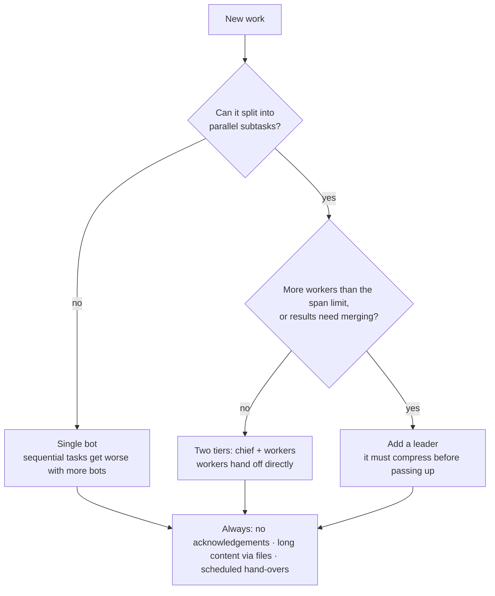

# Bot Token Optimization Guide

**English** · [繁體中文](guide.zh-TW.md)

In a multi-bot system, cost is roughly "wake-ups × calls per wake-up × context C". The most effective fixes reduce wake-ups and shrink C. Shortening the messages themselves helps very little.

Every formula and number here is computed by the tested scripts in `core/` and can be reproduced with the `bto` command (`pip install` this repo, or run `python3 core/cli.py`). Platform limits and prices in the examples are Grok Bot's; substitute your own for other bot platforms.

## Summary

The things to do first:

1. Ban pure acknowledgements ("got it", "OK") and batch notifications. Each acknowledgement makes the receiver re-read its whole context.
2. Remove leaders that only forward messages. A leader is worth having only if it compresses several results into one summary before passing it up.
3. Send long content one-to-one or through shared files; keep group chats to one-line status updates.
4. Hand over to a fresh chat on a schedule, using the reset threshold. Start with the chief: it has the largest C and is woken most often.
5. Poll less: a scheduled bot that usually finds nothing should run less often, or be pinged when something happens.
6. Let the formula find redundant bots: retire pure relays, merge bots that only pass work back and forth (`bto redesign`).
7. Export a usage CSV every week and let the advisor bot check whether the changes worked.

## Cost model

Every call to a bot re-reads its entire context C, so cost is the product of wake-ups, calls per wake-up, and C.

```math
\text{cost} \approx \sum_{\text{bot}} \Big( W \times R \times C \times p \;+\; W \times O \times o \Big), \qquad p = h \cdot r + (1 - h)
```

- W: wake-ups per day; R: calls per wake-up (1 + tool-call rounds for the bot's own work)
- C: current context size. It keeps growing with every message received, everything read in, and the bot's own output, until the bot hands over to a fresh context
- p: price factor. h is the cache hit rate, r is the cached price as a fraction of the full price
- O: output written per wake-up, including reasoning (thinking) tokens; o: output price as a multiple of the input price. Reasoning models can spend more on O than you expect, and every extra call adds more
- Once the prompt reaches 200K, the whole request is billed at the long-context price, i.e. double

| Price (grok-4.7, per million tokens) | input | cached input | output |
| --- | --- | --- | --- |
| prompt under 200K | $2.00 | $0.50 | $6.00 |
| prompt 200K or more | $4.00 | $1.00 | $12.00 |

Source: [mem0 Grok API pricing summary](https://mem0.ai/library/llms-and-models/xai-grok-api-pricing) (checked 2026-10). Presets for eight models (xAI, OpenAI, Anthropic, Google) live in `core/pricing/`; list them with `bto presets` and pick one with `--pricing`. Vendors differ in where the long-context tier starts and how steep it is (Grok 2× at 200K, OpenAI 2× input and 1.5× output above 272K, Claude Haiku 5× above 100K, none for several others). If your platform is subscription-based, dollar figures are cost equivalents for comparing options.

Three consequences follow directly:

- A message of length m is usually tiny next to C, so shortening messages helps little. Fewer wake-ups and a smaller C are the real levers.
- An "OK" is a few tokens, yet it makes the receiver pay for a full C.
- Whatever a bot reads stays in its C. Switching to "write to a board, then let them read it" does not slow the reader's context growth.

## Theory

Four formulas answer four common questions: is a board worth it, is a leader worth it, how many bots per manager, and when to reset.

### Is "write to a board, then ping" worth it?

When the receiver fetches the board with a tool call, every notification costs one extra full read of C. k is the number of tool-call rounds a bot spends on its own work per wake-up.

```math
\text{write, then notify: } \frac{k+2}{k+1} \qquad \text{write + notify in one step: } 1 + \frac{1}{2(k+1)}
```

| k | token multiplier (two steps) | token multiplier (one step) | receiver cost multiplier (cache cold on wake-up) |
| --- | --- | --- | --- |
| 0 (chatty bot) | 2.00 | 1.50 | 1.25 |
| 1 | 1.50 | 1.25 | 1.20 |
| 2 | 1.33 | 1.17 | 1.17 |
| 4 | 1.20 | 1.10 | 1.13 |


The multiplier does not depend on message length, only on how much work the bot does per wake-up. A board is valuable for collaboration and persistence, not for saving tokens.

```bash
bto board --k 1 --mode sequential
```

### Is a leader worth it?

Assume worker, leader and chief contexts of 30K, 60K and 100K:

| Scenario | Flat | With leader | Multiplier |
| --- | --- | --- | --- |
| Single task, leader only forwards | 130K | 250K | 1.92 |
| 6 parallel subtasks, leader sends one summary up | 780K | 700K | 0.90 |


A relay leader nearly doubles the cost. A summarizing leader moves wake-ups from the expensive chief to the cheaper leader, and the chief only receives one summary, so every later chief wake-up is cheaper too.

```bash
bto scenario relay
bto scenario aggregate --n 6
```

### How many bots per manager?

Every report wakes the manager once and stays in its context. C0 is the manager's base context, m the length of each report.

```math
k^{*} \approx 1 + \sqrt{1 + \frac{2 C_0}{m}}
```

| C0 | report length m | closed form k* | numerical optimum |
| --- | --- | --- | --- |
| 30K | 5K (full report) | 4.6 | 5 |
| 30K | 1K (summary) | 8.8 | 9 |
| 30K | 200 (one line + file path) | 18.3 | 19 |


The numerical optimum is computed for 2,000 workers with no cap. The shorter the reports, the more bots one manager can handle and the flatter the organization. Platforms add hard limits, e.g. a Grok Bot group holds at most 6 bots (`--platform grok-bot`).

```bash
bto span --n 12 --c0 30000 --m 1000 --platform grok-bot
```

### When to hand over to a fresh context

One reset costs roughly one read of C by the old bot to write a hand-over summary, plus the new bot's first read of its new context. Every wake-up after that saves the difference between C and the new context.

```math
C_{\text{new}} = C_{\text{base}} + H, \qquad \text{break-even wake-ups} = \frac{p \cdot C + 3H + C_{\text{new}}}{R \cdot p \cdot (C - C_{\text{new}})}
```

H is the hand-over summary length; 3 is the output-to-input price ratio. With an 8K base, a 3K hand-over, 10 wake-ups a day, over one week:

| Current C | break-even wake-ups | one-week net saving (USD equivalent) |
| --- | --- | --- |
| 50K | 2.6 | $2.10 |
| 100K | 1.7 | $4.86 |
| 150K | 1.4 | $7.62 |


For one bot whose context grows 15K a day with 10 wake-ups a day, never resetting costs about $17.47 over 14 days; handing over at 90K costs about $5.71.

In token terms, a reset pays for itself within two or three wake-ups. The real constraints are the knowledge lost in the hand-over and the manual effort of resetting, so in practice reset on a schedule: hand over before C reaches your quality soft cap or three quarters of the 200K tier. The scripts compute a suggested interval from the measured growth rate.

```bash
bto reset --c 150000 --c-base 8000 --wakes-per-day 10
```

## Choosing an architecture

Look at the task structure first, then the head count, and only then decide whether to add a layer.



In experiments by Google and collaborators, multi-agent setups lowered performance on sequential reasoning tasks by 39% to 70%, while centralized coordination improved parallelizable tasks by 80.9%. That is why the first question is whether the task can run in parallel.

## Practice

Eight anti-patterns account for most of the waste, and each can be fixed directly in your bots' instructions.

| Anti-pattern | How to spot it | Why it is expensive | Fix |
| --- | --- | --- | --- |
| Pure acknowledgements | "Got it", "OK": messages of a few tokens | Each makes the receiver re-read its full C | Forbid them in instructions; batch notifications, wake only when action is needed |
| Relay leader | One upstream, one downstream, passes on about as much as it receives | Two extra wake-ups per task | Let upstream and downstream hand off directly, or make the leader summarize |
| Polling and routine status reports | Scheduled check-ins, reporting every step | Wakes several bots each time | Notify only at milestones or exceptions |
| Long content in group chats | Hundreds of tokens per group message | Every message lands in every member's C | Long content one-to-one or via files; one-line status in groups |
| Notify, then read the board via a tool | The first call of a wake-up produces almost no output | One extra full C per notification | Put small content in the message; for large content, name the section to read |
| Printing machine output into the chat | Logs, scraped data, test output in the conversation | C balloons and is re-read on every wake-up | Write it to files with code; read only the parts needed |
| Never resetting | C keeps growing; slower and pricier over time | Every wake-up costs more; past 200K the unit price doubles | Scheduled hand-overs to a fresh chat |
| Micromanaging chief | The chief has the largest share of cost | Largest C times most wake-ups | Subordinates send summaries; the chief handles exceptions only |

The sample team in `samples/` shows the effect of fixing them (`bto compare samples/org_before.txt samples/org_after.txt`):


Each bar is that change's average saving over all 720 orders of applying the six changes (its Shapley value), so the bars add up exactly. The same redesign saves 85–97% on every pricing preset:


These are simulated numbers for example data, not a measured bill. The [advisor demo](advisor-demo.en.md) walks through a full consultation.

A long hand-off chain is also a latency problem: every hop is another round of waiting. `bto org` reports the longest chain and flags it at 5 hops or more.

Two formats you can adopt as-is:

- Hand-off notification: file path + one-line summary + what the receiver should do + which section to read. E.g. "board#42 v7 | API spec final | please implement /auth, only section 3 needed".
- Hand-over summary before a reset: goal, decisions made, open items, where the key files are. Keep it within about 3K tokens.

### Before a hand-over: what could be lost

The reset formula only counts tokens. Before you move a bot to a fresh chat, check what the summary must carry, because anything left out is gone:

- [ ] Decisions already made, and why (so the new chat does not reopen them)
- [ ] Constraints and preferences the user stated along the way
- [ ] Open items, owners and deadlines
- [ ] Where the files, boards and links are
- [ ] Mistakes already tried and rejected
- [ ] Anything another bot expects this bot to remember

If a bot's value lies mainly in long, unwritten memory (for example a customer history), hand over less often, or move that memory into a file first.

## Measuring and calibrating

A usage CSV gives the model real parameters. Only when the model reproduces your actual cost within ±15% should you use it to predict the effect of a redesign.

1. Export a usage CSV from your bot platform, ideally covering at least 7 days and all bots.
2. Run `bto report usage.csv --platform grok-bot --tz +08:00 [--schedules schedules.txt] [--quota-days N | --goal-usd-week N]` for the one-page memo: bottom line, who costs what, ranked changes, data gaps, KPIs with a check date and a change request ([example](sample-memo-grok.en.md)).
3. For the per-context detail, run `bto analyze usage.csv --platform grok-bot --org-out org.json`: it maps columns automatically and computes, per context, wake-ups, calls per wake-up, current C, daily growth and cache hit rate. `bto trend` shows spend per day and a same-window comparison with the day before.
4. Check the "model calibration" error. Above ±15%, rely on the measured findings; the usual causes are mixed chats, an unsuitable wake-up gap or non-linear growth.
5. Add who talks to whom (start from `bto report --org-out org.json`, or describe the team in org.txt / with `bto init`) and run `bto org` for a diagnosis.
6. Run `bto redesign` for redundant bots, merges, splits and the new org chart; compare options you write yourself with `bto compare`.
7. Export the same window again after the changes and re-run the report to confirm the effect.

Detection rules (all heuristics; check them against the actual conversations):

| Detection | Condition | Matching anti-pattern |
| --- | --- | --- |
| Low-output wake-ups | One call with ≤ 30 output tokens, in 15% or more of wake-ups | Pure acknowledgements, wake-ups with nothing to do |
| Read-then-work | Two or more calls, first call ≤ 80 output tokens, in 30% or more of wake-ups | Notify, then read the board via a tool |
| Whole-board reads | In read-then-work wake-ups, the second call's prompt minus the first call's prompt and answer has a median of 4,000 tokens or more (rising = the board is growing) | A board nobody trims, read in full |
| Context growth | Trend crosses 200K within 14 days | Never resetting |
| Long-context billing | Calls already above 200K | Never resetting |
| Low cache hit rate | Below 50% (at least 10 calls) | Editing early context, long gaps between wake-ups |
| Cost hotspot | 30% or more of total cost and above 1.5 / number of bots | Micromanaging chief, too many wake-ups |

Wake-ups are estimated by treating consecutive calls of the same context within 120 seconds as one wake-up; adjust with `--gap`.

Three details make the measurements trustworthy:

- **Every chat is its own context.** A bot running several chats or threads keeps a separate context in each, so the analyzer reports `bot/chat` rows when the CSV has a chat column. Mixing them would blur both size and growth.
- **Hand-overs you already made are detected.** A wake-up whose context is below 60% of the previous one (and at least 5K smaller) starts a new segment. Growth is measured within segments, so a sawtooth does not look like a slow, flat line.
- **Output is priced too.** Calibration compares the model's input + output cost with the actual spend (the CSV's cost column when present).

### From numbers to advice

`bto report` turns the analysis into recommendations a client can act on:

- **Cost anatomy.** Spend is split into uncached input, cached input, output and the long-context premium. On most teams over 90% is re-reading context, which points at fewer wake-ups and smaller contexts rather than shorter answers.
- **Evidence tiers.** *Measured*: dollars already spent on a removable pattern in the export (acknowledgement wake-ups, board-first calls, cache misses inside a wake-up, the long-context premium); the range is removing half to all of it. *Modeled*: the hand-over policy, priced with the reset model (`bto reset`); a context handed over at threshold $T$ averages about $(C_{\text{fresh}} + T)/2$ and needs $G/(T - C_{\text{fresh}})$ hand-overs a week for growth $G$, each costing one rebuild. Every threshold from 40K to 150K is priced for every context, and each gets the one that saves most within a weekly limit (7 by default); a context that cannot stay within it becomes a priced decision. Trusted when calibration is within ±15%. *Judgment*: the sensitivity of the biggest bucket to 10–30% fewer wake-ups, kept out of the total.
- **Ranking.** Actions are ordered by dollars × confidence ÷ effort; anything under 1% of weekly spend is dropped. The combined saving counts each dollar once (a hand-over absorbs the long-context premium of the same context).
- **What changed.** Same-window comparison (today so far vs the same hours yesterday, in your time zone) and first-half vs second-half per context: dollars, wake-ups and average context, so you can tell "woken more often" from "reading more each time". Days inside a quota gap are listed as 0 with a no-data note, and the half-vs-half split uses active time so the gap itself is not reported as a drop.
- **Automatic summarization.** A context that keeps resetting between two similar levels (the peaks vary by less than 25%) is flagged as a sawtooth. On Grok Bot this usually means the platform summarizes at a high threshold; a manual hand-over at a lower one saves most of the difference.
- **Board size.** What a read-then-work wake-up fetches is measured from the export. When it is large, the memo proposes reading only the needed section and having one bot maintain the board (archive finished items, one line of status per open item, a size limit), priced with the board model (`bto board --board … --section …`) under the platform's own summarizing; the hand-overs are then priced on the slower growth.
- **Quota days.** `--quota-days 3` (the quota lasts 3 days at this pace) sets the budget to $S \cdot 3/7$ and the memo states how many days the quota lasts after the recommendations; `bto quota` does the same arithmetic for any figures. A zero-row stretch longer than `--max-gap` is only a candidate quota gap. It counts when at least 3 full clock hours inside it are hours this export is normally busy, so overnight quiet and rest days stay in the span. A rest day is a weekday whose full dates (at least 2) are all empty. Days and hours use `--tz` when it is set, otherwise the quiet-point clock (the middle of the longest run of UTC hours that are not busy). Under two weeks, rest days are not judged and a warning is printed. If an outage empties every full date of a weekday, that weekday is treated as rest. A normally off weekday that was worked even once (for example one Saturday with traffic) is no longer treated as a rest day, so the other empty dates of that weekday can be counted as quota gaps and raise the weekly rate and can infer a quota cycle that does not exist. Improved off-day detection is tracked in [#12](https://github.com/EndeavorYen/bot-token-optimizer/issues/12). The memo names each counted gap and the active-day denominator. Only complete cycles are used as quota days; otherwise quota days are omitted unless `--quota-days` is given.
- **Naming the bots inside a bucket.** When the export has no bot id, `--schedules schedules.txt` (one bot per line: `every 30m [08:00-22:00]`, `at 09:00,18:00` or a 5-field `cron`, optionally `in=BUCKET`) matches each fire to the wake-up that starts from 60 s before to 5 min after it, nearest first, one wake-up per fire. Each bot then gets its own $/week, cost per wake-up, context and share of checks that found nothing to do (one call, at most 80 output tokens), and the rest of the bucket is shown as unscheduled traffic. A bot whose checks are mostly idle gets a concrete frequency change: the new interval is the old one ÷ (1 − idle share), rounded up to a round value, and the saving is the measured cost per wake-up × the wake-ups removed. The hand-over is then priced on the wake-ups that remain, so the two are not counted twice. The memo ends the recommendations with one change request for the bot that manages the others.
- **Data gaps.** Missing bot or chat ids, an empty Automation ID (calls are then grouped by model, e.g. `grok-bot-default`), no cache column, a short export, a calibration error, plan billing. Each comes with its fix and lowers the stated confidence instead of blocking the advice.

### Describing your team

The CSV cannot show who woke whom, so the links come from you. The shortest way is `org.txt`, one line per bot, link or group:

```text
settings horizon=7 soft_cap=120k
bot chief      100k base=8k wakes=3 rounds=1
bot researcher 30k  rounds=3 board
chief -> researcher : 6/day 800
researcher -> chief : 6/day 15
group team : chief researcher : 10/day 300 wake=all
```

Bot options: `base` (setup kept after a reset), `wakes` (wake-ups not caused by other bots), `rounds` (tool-call rounds of own work), `board` (reads a board after each ping), `out` / `reasoning` (tokens written per wake-up), `cache` (hit rate), `growth` (measured growth per day). Numbers accept `k` and `M`. `bto init` asks the questions for you; `bto convert` switches between org.txt and org.json. Every problem is reported at once, with line numbers.

### Redesigning the organization

`bto redesign org.txt` searches for a cheaper organization of the same bots with the cost model, one change at a time, keeping the change that saves most until nothing saves at least 2% of the total:

| Change | When it is tried | What the formula weighs |
| --- | --- | --- |
| Drop acknowledgements, content in the message, one-line group status | always (instruction level) | wake-ups and board reads removed |
| Retire a bot (redundant) | one upstream, one downstream, no tool work or own wake-ups, passes on about what it receives | its context no longer read; the hand-off goes direct |
| Merge two bots | they hand work to each other, or share a manager | fewer contexts and no hand-off wake-ups, against one larger context (both bases kept) read on every wake-up |
| Split a bot | it serves three or more sources | two smaller contexts, against a short summary exchanged twice a day |
| Add summarizing leaders | a manager has more direct reports than the span limit | the span formula $k^{*}$ sets the group size; each leader sends one summary per round |

To compare structures fairly, every option is evaluated over four weeks under the same hand-over policy (`handover_at`, default the soft cap or 120K), with every context starting at most at that threshold; otherwise a structure could look cheaper just because it starts with fresh chats. Bots marked `keep` are never retired or merged away. The formula cannot see whether two jobs belong together: a merge is a candidate until someone checks that the bots need the same tools and access and that neither reviews the other. The output lists the redundant bots, every change with its saving (they add up in order), the current and proposed org charts as Mermaid diagrams, and a change request for the managing bot. `bto report --org-out` writes a skeleton from the measured contexts and named bots to start from.

## Advisor bot

The advisor bot is called only when needed and works like a cost consultant, not a calculator: it frames the goal, diagnoses, recommends, plans and sets up the check. Every number comes from the tested tools; the bot frames, interprets, prioritizes and writes. Its playbook for Grok Bot is in `adapters/grok-bot/ADVISOR_BOT.en.md` (Chinese: `ADVISOR_BOT.zh-TW.md`); the [advisor demo](advisor-demo.en.md) shows a full engagement.

| When to call it | What you get | What you provide |
| --- | --- | --- |
| Usage burning too fast | A three-sentence bottom line naming the costliest bot, concrete changes with $/week and confidence, how many days the quota will last, the one-page memo and a change request | A usage export, your time zone, and the goal (a weekly budget, or how many days the quota must last) |
| Planning a reorg | Redundant bots, merges and splits with their savings, the current and proposed org charts, and a change request | Nothing beyond the export: it reads who talks to whom itself |
| "What if" questions | The answer first, then the number from the matching tool and the assumption that matters | A few parameters, e.g. C and wake-ups per day |

How it works: it investigates before it asks (schedules, instructions, groups, who notifies whom) and asks you only about goals, constraints and approval; every recommendation names the bot, the current and the proposed setting, and comes as a request the managing bot can execute; answer first in dollars per week; plain words; no internal plumbing (tests, paths, commands) in the answer; recommendations instead of menus, with at most one question; every figure labeled measured, modeled or judgment; the biggest driver raised even if you asked about something else; KPIs with a check date; and the fresh-chat reminder once, at the end.

## Limits and references

The model gives direction and magnitude, not an exact bill. Keep these limits in mind:

- It assumes every call re-reads the full C; platforms that compress context automatically will cost less.
- Context growth between hand-overs is approximated as linear.
- Calibration so far is on synthetic data generated from the model's own assumptions, so the small error there proves little. Real exports are the real test.
- Vendors that charge more for cache writes than for plain input (OpenAI, Anthropic) are modeled at the cache-read price only, which slightly understates cost.
- Quality is not in the cost formula: attention degrades in long contexts and knowledge is lost in hand-overs; judge those separately.
- Latency is not modeled: every extra layer adds a round of waiting.
- The Grok Bot usage-events export is read as is (three prompt columns summed, cloud-agent rows left out, text cost priced from tokens), but it has no chat id and Automation ID is often empty. Calls without an Automation ID are grouped by model (e.g. `grok-bot-default`), so each bucket can hold several bots and several chats; the dollar split is right, while growth and calibration are blended. Context percentiles stay valid. Check the column mapping and calibration error the first time you use a real export.
- Prices change; estimated savings overlap and cannot simply be added up.

Recent multi-agent research:

- [Towards a Science of Scaling Agent Systems](https://arxiv.org/abs/2512.08296): centralized coordination improves parallelizable tasks by 80.9%; on sequential reasoning tasks multi-agent setups lose 39% to 70%; with centralized coordination errors are amplified 4.4×, with independent agents 17.2×.
- [AgentPrune (ICLR 2025)](https://proceedings.iclr.cc/paper_files/paper/2025/hash/bbc461518c59a2a8d64e70e2c38c4a0e-Abstract-Conference.html): pruning redundant communication cuts tokens by 28.1% to 72.8%.
- [AgentSlimming (ACL 2026)](https://preview.aclanthology.org/ingest-acl/2026.acl-long.1387/): removing or replacing redundant agents cuts token cost by up to 78.9%.
- [OrgAgent](https://arxiv.org/abs/2604.01020): company-style hierarchies generally outperform other organizational structures.
- [Embodied LLM Agents Learn to Cooperate in Organized Teams](https://arxiv.org/abs/2403.12482): LLM agents tend to over-report and comply with everything; adding organizational structure helps.

Platform and pricing: [xAI Responses API docs](https://docs.x.ai/docs/guides), [Introducing Grok Bot](https://x.ai/news/introducing-grok-bot), [Grok API pricing summary](https://mem0.ai/library/llms-and-models/xai-grok-api-pricing).

Classic organization theory: Williamson (1967) on hierarchical control and optimum firm size, Marschak and Radner (1972) on team theory, Radner (1993) on decentralized information processing, Garicano (2000) on knowledge hierarchies, Simon (1962) on near-decomposability.
