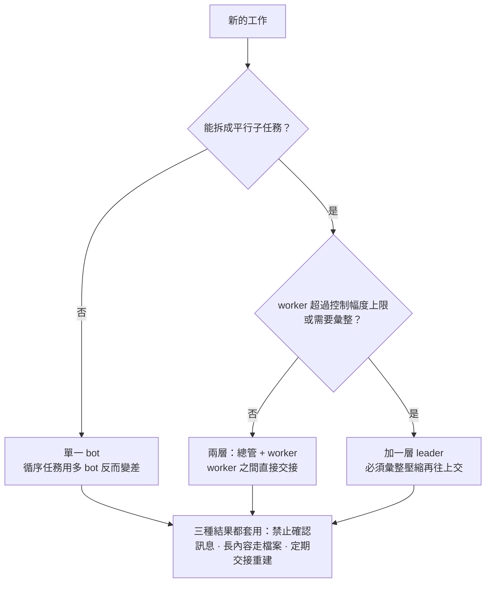

# Bot Token 最佳化指引

[English](guide.en.md) · **繁體中文**

多 bot 系統的成本約等於「喚醒次數 × 每次喚醒的呼叫輪數 × 上下文 C」。最有效的改善是減少喚醒、縮小 C，而不是縮短訊息本身。

本文的公式與數字都由 `core/` 中經過測試的腳本計算，可用 `bto` 指令重算（`pip install` 這個 repo，或直接執行 `python3 core/cli.py`）。範例中的平台限制與價格以 Grok Bot 為準，其他 bot 平台請替換成自己的數字。

## 摘要

最該先做的五件事：

1. 禁止純確認訊息（「收到」「OK」），把通知合併。每則確認都會讓對方重讀一次完整上下文。
2. 拿掉只轉話的 leader。leader 必須把多份結果壓縮成一份摘要往上交，才值得存在。
3. 長內容走一對一或共享檔案，群組只放一行狀態。
4. 依重建門檻定期交接、開新 chat，總管優先，因為它的 C 最大、最常被叫醒。
5. 每週匯出一次 usage CSV，交給顧問 bot 驗證改善效果。

## 成本模型

bot 每被呼叫一輪，就要重讀一次完整上下文 C，所以成本由喚醒次數、每次喚醒的輪數和 C 三者相乘決定。

```math
\text{成本} \approx \sum_{\text{bot}} \Big( W \times R \times C \times p \;+\; W \times O \times o \Big), \qquad p = h \cdot r + (1 - h)
```

- W：每天被喚醒幾次；R：每次喚醒的呼叫輪數（1 + 為自己工作做的工具呼叫輪數）
- C：當下的上下文大小，會隨收到的訊息、讀進來的內容、自己的輸出持續成長，直到交接重建
- p：價格係數。h 是快取命中率，r 是快取價相對原價的比例
- O：每次喚醒寫出的 output，包含推理（思考）token；o：output 價相對 input 價的倍數。推理模型花在 O 上的可能比你想的多，而且每多一輪呼叫就多一份
- 上下文達到 200K 時，整個請求改用長上下文價格，單價翻倍

| 價目（grok-4.7，每百萬 token） | input | 快取 input | output |
| --- | --- | --- | --- |
| prompt 低於 200K | $2.00 | $0.50 | $6.00 |
| prompt 達 200K 以上 | $4.00 | $1.00 | $12.00 |

價目來源：[mem0 Grok API 價目整理](https://mem0.ai/library/llms-and-models/xai-grok-api-pricing)（2026-10 查詢）。`core/pricing/` 內有 8 個模型的價格設定（xAI、OpenAI、Anthropic、Google），用 `bto presets` 列出、用 `--pricing` 選用。各家的長上下文門檻位置和加價幅度都不同（Grok 在 200K 起 2 倍；OpenAI 在 272K 以上 input 2 倍、output 1.5 倍；Claude Haiku 在 100K 以上 5 倍；另有幾家沒有加價）。若平台為訂閱制，美元數字代表等值成本，用來比較方案。

這個模型帶出三個直接推論：

- 訊息長度 m 通常遠小於 C，縮短訊息幫助有限；減少喚醒和縮小 C 才是主要槓桿。
- 一則「收到」只有幾個 token，卻讓對方付一整次 C。
- 讀進來的內容會留在讀者的 C 裡，改成「寫 board 再去讀」對讀的人不會讓 C 長得比較慢。

## 理論面

四組公式回答四個常見問題：board 值不值得、leader 值不值得、一個主管帶幾個、何時重建。

### 寫 board 再通知值不值得

對方用 tool 讀 board 時，每次通知會多一輪完整 C。k 是每次喚醒為自己工作做的工具呼叫輪數。

```math
\text{依序寫 board 再通知：} \frac{k+2}{k+1} \qquad \text{寫 board 與通知同一輪：} 1 + \frac{1}{2(k+1)}
```

| k | token 倍數（依序） | token 倍數（同一輪） | 接收方成本倍數（喚醒時快取失效） |
| --- | --- | --- | --- |
| 0（純對話型） | 2.00 | 1.50 | 1.25 |
| 1 | 1.50 | 1.25 | 1.20 |
| 2 | 1.33 | 1.17 | 1.17 |
| 4 | 1.20 | 1.10 | 1.13 |


倍數跟訊息長度無關，只看 bot 每次喚醒做多少事。board 的價值在協作與持久化，不在省 token。

```bash
bto board --k 1 --mode sequential
```

### leader 值不值得

假設 worker、leader、總管的 C 分別是 30k、60k、100k：

| 情境 | 扁平 | 有 leader | 倍數 |
| --- | --- | --- | --- |
| 單一任務，leader 只轉話 | 130k | 250k | 1.92 |
| 6 個平行子任務，leader 彙整後交一份摘要 | 780k | 700k | 0.90 |


只轉話的 leader 讓成本接近翻倍。會彙整的 leader 把喚醒從最貴的總管移到較便宜的 leader，而且總管只收一份摘要，之後每次喚醒也更便宜。

```bash
bto scenario relay
bto scenario aggregate --n 6
```

### 一個主管該帶幾個

主管每收一則回報就被喚醒一次，回報會累積在它的上下文裡。C0 是主管的基礎上下文，m 是每則回報長度。

```math
k^{*} \approx 1 + \sqrt{1 + \frac{2 C_0}{m}}
```

| C0 | 每則回報 m | 封閉解 k* | 數值最佳解 |
| --- | --- | --- | --- |
| 30k | 5k（完整報告） | 4.6 | 5 |
| 30k | 1k（摘要） | 8.8 | 9 |
| 30k | 200（一行狀態 + 檔案路徑） | 18.3 | 19 |


數值最佳解以 2,000 個 worker、不設上限計算。回報寫得越短，主管能帶的人越多、組織越扁平。實務上還有平台的硬上限，例如 Grok Bot 一個群組最多 6 個 Bot（`--platform grok-bot`）。

```bash
bto span --n 12 --c0 30000 --m 1000 --platform grok-bot
```

### 何時交接重建

重建一次的成本，約等於舊 bot 讀一次 C 來寫交接摘要，加上新 bot 第一次讀新的上下文。之後每次喚醒都省下 C 與新上下文的差距。

```math
C_{\text{new}} = C_{\text{base}} + H, \qquad \text{回本喚醒次數} = \frac{p \cdot C + 3H + C_{\text{new}}}{R \cdot p \cdot (C - C_{\text{new}})}
```

其中 H 是交接摘要長度，3 是 output 相對 input 的價格倍數。以基礎設定 8k、交接摘要 3k、每天喚醒 10 次、一週為例：

| 目前 C | 回本喚醒次數 | 一週淨省（等值美元） |
| --- | --- | --- |
| 50k | 2.6 | $2.10 |
| 100k | 1.7 | $4.86 |
| 150k | 1.4 | $7.62 |


以單一 bot、上下文每天成長 15K、每天喚醒 10 次為例：從不重建的 14 天成本約 $17.47，上下文到 90K 就交接則約 $5.71。

只看 token，重建幾乎都在兩三次喚醒內回本。真正的限制是交接時遺失的知識，以及手動重建的人力，所以實務上採「定期重建」：在 C 長到品質軟上限或 200K 門檻的四分之三之前交接。腳本會依實測成長速度算出建議週期。

```bash
bto reset --c 150000 --c-base 8000 --wakes-per-day 10
```

## 架構決策

架構選擇先看任務結構，再看人數，最後才決定要不要加層級。



依據 Google 等團隊的實驗，循序推理任務改用多 agent 時表現下降 39% 到 70%，可平行的任務用集中協調則提升 80.9%，所以第一個判斷是任務能不能平行。

## 實際面

八個反模式涵蓋了大部分的浪費，每一個都可以直接寫進 bot 的指令裡改善。

| 反模式 | 怎麼認出來 | 為什麼貴 | 改善做法 |
| --- | --- | --- | --- |
| 純確認訊息 | 「收到」「OK」這類幾個 token 的訊息 | 每則都讓對方重讀一次完整 C | 指令中禁止；合併通知，只在需要行動時喚醒 |
| 只轉話的 leader | 一個上游、一個下游，往下傳的內容和收到的差不多長 | 每個任務多兩次喚醒 | 讓上下游直接交接，或改成彙整壓縮 |
| 輪詢進度、定期回報 | 定時 check-in、每步都向上報告 | 每次都喚醒好幾個 bot | 只在里程碑或例外時通知 |
| 群組傳長內容 | 群組裡每則數百 token | 每則都進入所有成員的 C | 長內容走一對一或檔案，群組只留一行狀態 |
| 通知後用 tool 讀 board | 喚醒的第一輪幾乎沒有輸出 | 每次通知多一輪完整 C | 小內容直接放進訊息；大內容註明要讀哪一段 |
| 把機器產出印到對話 | log、爬蟲結果、測試輸出出現在對話中 | C 暴增，之後每次喚醒都要重讀 | 用程式直接寫檔，只讀需要的部分 |
| 長期不重建 | C 持續成長，越用越慢越貴 | 每次喚醒都更貴，越過 200K 單價翻倍 | 依門檻定期交接、開新 chat |
| 總管管太細 | 總管占總成本比例最高 | 最大的 C 乘上最多的喚醒 | 下屬交摘要，總管只處理例外 |

改掉這些反模式的效果，可以用範例團隊來看（`bto compare samples/org_before.txt samples/org_after.txt`）：


每根橫條是該項改變在六項改變全部 720 種套用順序下的平均節省（Shapley 值），所以加總恰好等於總節省。同樣的改組在每個價格設定下都能省 85%～97%：


這是模型對範例資料的模擬結果，不是實際帳單。[顧問示範](advisor-demo.zh-TW.md)有一次完整的諮詢過程。

交接鏈太長也是延遲問題：每多一跳就多一輪等待。`bto org` 會列出最長的交接鏈，達 5 跳以上時提出警示。

兩個可以直接套用的格式：

- 交接通知：檔案路徑 + 一句摘要 + 要對方做什麼 + 要讀哪一段。例如「board#42 v7｜API 規格已定稿｜請實作 /auth，只需讀第 3 節」。
- 重建前的交接摘要：目標、已做的決定、未完成事項、重要檔案位置，控制在約 3k token 以內。

### 交接之前：哪些東西可能會遺失

重建門檻的公式只算 token。把 bot 移到新的 chat 之前，請確認交接摘要帶走了必要的內容，因為沒寫進去的就會消失：

- [ ] 已經做出的決定和理由（避免新 chat 重新討論）
- [ ] 使用者過程中提過的限制和偏好
- [ ] 未完成事項、負責人與期限
- [ ] 檔案、board 和連結的位置
- [ ] 已經試過、被否決的做法
- [ ] 其他 bot 期待這個 bot 記得的事

如果一個 bot 的價值主要在於大量沒寫下來的記憶（例如客戶往來紀錄），就降低交接頻率，或先把這些記憶整理成檔案。

## 量測與校正

usage CSV 提供模型需要的真實參數；模型回推的成本與實際誤差在 ±15% 內，才用它推估改組效果。

1. 從 bot 平台匯出 usage CSV，最好涵蓋至少 3 天、包含所有 bot。
2. 執行 `bto analyze usage.csv --platform grok-bot --org-out org.json`：自動對應欄位，依每份上下文算出喚醒次數、每次喚醒輪數、目前 C、每日成長、快取命中率。
3. 檢查報告中的「模型校正」誤差。超過 ±15% 時只採用實測發現，常見原因是喚醒切分間隔不合適或成長不是線性。
4. 補上 bot 之間的溝通關係（編輯 org.json，或用 org.txt／`bto init` 描述團隊），執行 `bto org` 取得診斷。
5. 寫出改組方案，用 `bto compare` 比較前後總成本。
6. 改完一週後再匯出一次 CSV，確認實際效果。

分析器的偵測規則（皆為啟發式，請對照實際對話確認）：

| 偵測 | 判斷條件 | 對應的反模式 |
| --- | --- | --- |
| 低產出喚醒 | 只呼叫一輪且輸出 ≤ 30 token，占喚醒 15% 以上 | 純確認訊息、無事可做的喚醒 |
| 先讀再做 | 兩輪以上、第一輪輸出 ≤ 80 token，占喚醒 30% 以上 | 通知後用 tool 讀 board |
| 上下文成長 | 依成長趨勢 14 天內會越過 200K | 長期不重建 |
| 長上下文計價 | 已有呼叫超過 200K | 長期不重建 |
| 快取命中偏低 | 命中率低於 50%（至少 10 次呼叫） | 修改早期上下文、喚醒間隔太長 |
| 成本熱點 | 占總成本 30% 以上且高於 1.5 / bot 數 | 總管管太細、喚醒過多 |

喚醒次數是用「同一份上下文連續呼叫間隔 120 秒內視為同一次喚醒」切分的估計值，可用 `--gap` 調整。

有三個細節讓量測結果可信：

- **每個 chat 是獨立的上下文。** 一個 bot 同時跑好幾個 chat 或 thread 時，每個都各自累積上下文，所以 CSV 有 chat 欄位時，分析器會以 `bot/chat` 為單位列出。混在一起算，大小和成長速度都會失真。
- **會偵測你已經做過的交接。** 某次喚醒的上下文小於前一次的 60%（而且至少少 5K）時，視為新的一段。成長速度在每一段內計算，所以鋸齒狀的資料不會被誤判成緩慢平坦的直線。
- **output 也一起計價。** 校正時比較的是模型的 input + output 成本與實際花費（CSV 有成本欄位時直接採用）。

### 描述你的團隊

CSV 看不出誰叫醒了誰，所以溝通關係要由你提供。最簡單的方式是 `org.txt`，一行一個 bot、一條關係或一個群組：

```text
settings horizon=7 soft_cap=120k
bot chief      100k base=8k wakes=3 rounds=1
bot researcher 30k  rounds=3 board
chief -> researcher : 6/day 800
researcher -> chief : 6/day 15
group team : chief researcher : 10/day 300 wake=all
```

bot 的選項：`base`（重建後保留的基礎設定）、`wakes`（不是由其他 bot 造成的喚醒）、`rounds`（為自己工作做的工具呼叫輪數）、`board`（每次被通知後先讀 board）、`out`／`reasoning`（每次喚醒寫出的 token）、`cache`（快取命中率）、`growth`（實測的每日成長）。數字可以用 `k` 和 `M`。`bto init` 會用問答幫你產生；`bto convert` 可以在 org.txt 和 org.json 之間轉換。所有問題會一次列出，並標明行號。

## 顧問 bot

顧問 bot 只在需要時被呼叫，所有數字都由已驗證的腳本計算，它負責收集資訊、解讀結果和給建議。Grok Bot 版的指令在 `adapters/grok-bot/ADVISOR_BOT.zh-TW.md`（英文版 `ADVISOR_BOT.en.md`）。

| 什麼時候叫它 | 它會做什麼 | 你要準備 |
| --- | --- | --- |
| 覺得用量消耗太快 | 分析 CSV、校正模型、找出反模式與最貴節點、給前三項改善 | usage CSV，回答一次溝通關係的訪談 |
| 想改組 | 建立現況與 1～2 個方案，用 compare 比較總成本、熱點與層數 | 現有 bot 與溝通關係 |
| 理論問題 | 用對應指令算出結論（board、leader、控制幅度、重建） | 幾個參數，例如 C 與每天喚醒次數 |

它遵守自己的規則：不心算、不回確認訊息、一次問完問題、標明啟發式判斷，諮詢結束後建議下次開新 chat。

## 限制與參考文獻

模型抓的是方向和量級，不是精確帳單；以下限制在解讀結果時要記得。

- 假設每輪呼叫都讀完整 C；平台若有自動壓縮上下文，實際成本會較低。
- 兩次交接之間的上下文成長以線性近似。
- 目前的校正只用過依模型假設產生的合成資料，所以那裡的小誤差證明不了什麼，真實匯出檔才是真正的考驗。
- 對快取寫入另外收費、而且比一般 input 貴的廠商（OpenAI、Anthropic），模型只用快取讀取價計算，成本會略為低估。
- 品質沒有進入成本公式：上下文太長時注意力下降、交接時知識遺失，都要另外判斷。
- 延遲另外計算：每多一層就多一輪等待。
- Grok Bot 的 usage-events 匯出檔可以直接讀（三個 prompt 欄加總、排除雲端執行列、文字成本改用 token 推算），但它沒有 bot 或 chat 欄位，除非自己補 bot 欄，否則所有呼叫算成一份上下文。第一次使用真實檔案時，請確認欄位對應與校正誤差。
- 價目會變動；各項預估省量互相重疊，不能直接相加。

近年的多 agent 研究：

- [Towards a Science of Scaling Agent Systems](https://arxiv.org/abs/2512.08296)：在可平行任務上集中協調提升 80.9%，在循序推理任務上多 agent 架構讓表現下降 39% 到 70%；有集中協調時錯誤放大 4.4 倍，獨立 agent 達 17.2 倍。
- [AgentPrune（ICLR 2025）](https://proceedings.iclr.cc/paper_files/paper/2025/hash/bbc461518c59a2a8d64e70e2c38c4a0e-Abstract-Conference.html)：剪除冗餘溝通，token 減少 28.1% 到 72.8%。
- [AgentSlimming（ACL 2026）](https://preview.aclanthology.org/ingest-acl/2026.acl-long.1387/)：移除或替換多餘 agent，token 成本最多降低 78.9%。
- [OrgAgent](https://arxiv.org/abs/2604.01020)：公司式階層普遍優於其他組織結構。
- [Embodied LLM Agents Learn to Cooperate in Organized Teams](https://arxiv.org/abs/2403.12482)：LLM agent 傾向過度回報與照單全收，加入組織結構後改善。

平台與價目：[xAI Responses API 文件](https://docs.x.ai/docs/guides)、[Introducing Grok Bot](https://x.ai/news/introducing-grok-bot)、[Grok API 價目整理](https://mem0.ai/library/llms-and-models/xai-grok-api-pricing)。

組織理論的經典：Williamson（1967）層級控制與最適規模、Marschak 與 Radner（1972）團隊理論、Radner（1993）分散式資訊處理、Garicano（2000）知識階層、Simon（1962）近可分解性。
