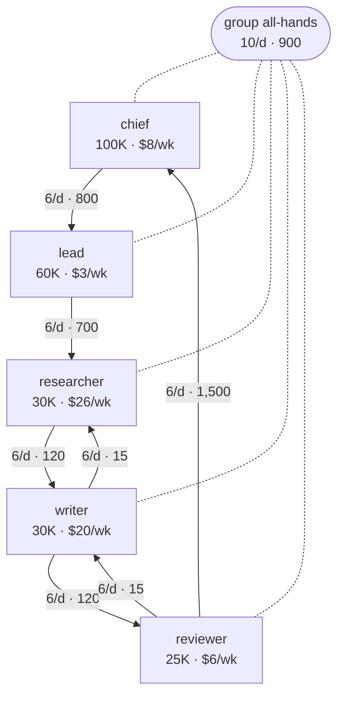
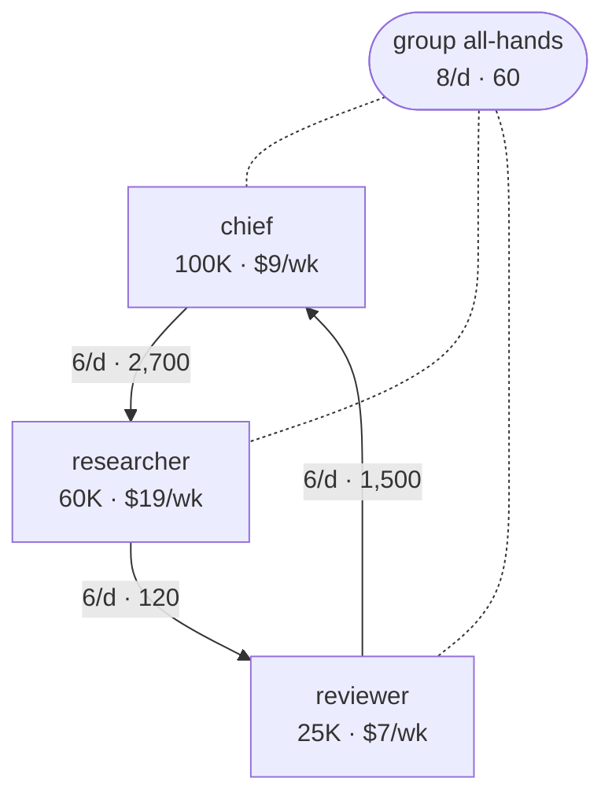

## Organization redesign

Today the team costs about **$62.87/week**. Instruction changes alone bring it to **$36.39** (0.58×); with the structural changes below, **$32.33** (0.51×).

**Redundant by the numbers:** lead. Each only passes work on; the hand-off can go direct and the team costs less without it.

**Jobs to combine:** writer → researcher. The work stays; it moves into the other bot, saving a context and the hand-offs between them.

| # | Change | Level | Saves / week |
|---|---|---|---|
| 1 | Drop acknowledgement messages (writer → researcher, reviewer → writer) | instructions | $19.40 |
| 2 | Send the needed section in the message instead of a board read (researcher, writer) | instructions | $5.82 |
| 3 | Group all-hands: one-line status (about 60 tokens), long content one-to-one | instructions | $1.26 |
| 4 | Retire **lead**: it only passes work from chief to researcher; chief hands over to researcher directly | structure | $3.19 |
| 5 | Merge **writer** into **researcher**: they hand work to each other (or share a manager); one context of about 60,000 tokens instead of two plus the hand-offs. Check first that writer need not stay independent of researcher (review, approval) and needs no tools or access researcher lacks | structure | $0.87 |

All costs assume every bot hands over to a fresh chat at 120,000 tokens, so structures are compared on equal terms. Each change is kept only if the cost model says it saves at least 2% of the total at that point, so the savings add up in this order. Span limit 6; merged contexts stay under 120,000 tokens; bots marked keep are never retired or merged away. Whether two jobs can share one bot is a judgment to check before merging.

### Organization today



### Organization after the changes



### Paste to the main bot

```text
Please make these changes to my bots and report the result of each one:
1. Add to every bot's instructions: “Do not reply ‘OK’ or ‘got it’ to a notification. Send a message only when the receiver has to act.”
2. Add to every bot's instructions: “When you notify another bot, include the content itself if it is a paragraph or less. For longer content, write it to a file and give the path and the exact section to read.”
3. In group all-hands, post only one-line status updates; send anything longer one-to-one to the bot that needs it.
4. Have chief send its work directly to researcher instead of through lead; then pause lead (do not delete it yet).
5. Move writer's duties into researcher's instructions, point everything that went to writer at researcher, then pause writer (do not delete it yet).
Do not change anything else.
```

