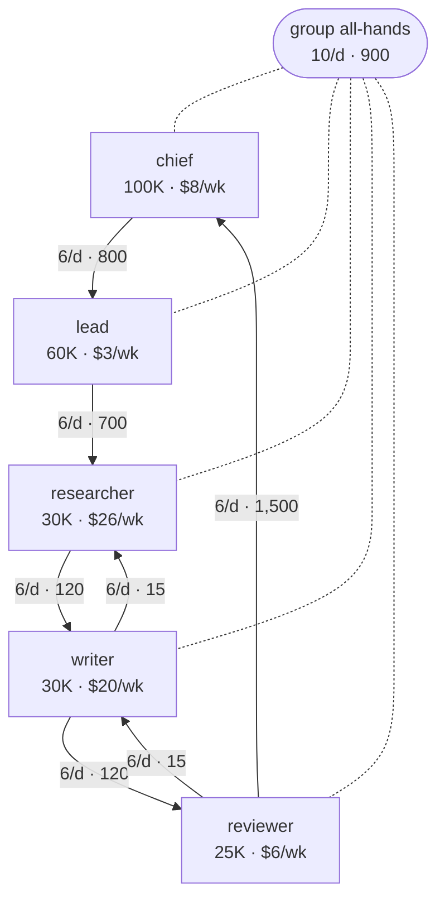
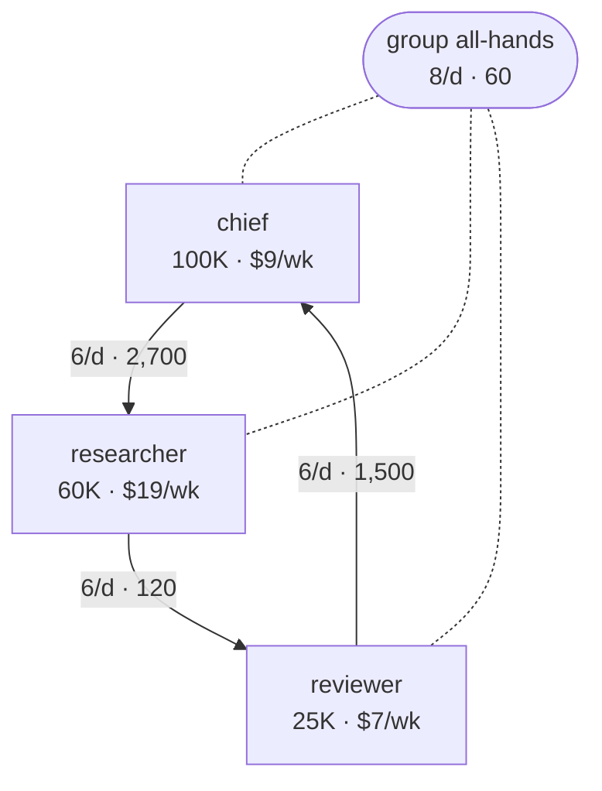

## 組織改造

目前團隊每週約 **$62.87**。只改指令可降到 **$36.39**（0.58 倍）；加上下面的結構調整，可降到 **$32.33**（0.51 倍）。

**依數字判斷為冗員：** lead。它們只負責轉交工作，改成直接交接後，整體更省。

**可合併的工作：** writer → researcher。工作還在，只是移到另一個 bot，省下一份上下文和兩者之間的交接。

| # | 變更 | 層級 | 每週可省 |
|---|---|---|---|
| 1 | 取消純確認訊息（writer → researcher, reviewer → writer） | 指令 | $19.40 |
| 2 | 內容直接放進訊息，不再讀 board（researcher, writer） | 指令 | $5.82 |
| 3 | 群組 all-hands：只貼一行狀態（約 60 token），長內容改走一對一 | 指令 | $1.26 |
| 4 | 拿掉 **lead**：它只是把 chief 的工作轉給 researcher；改成 chief 直接交給 researcher | 結構 | $3.19 |
| 5 | 把 **writer** 併入 **researcher**：兩者互相交接（或同一個主管），合成一個約 60,000 token 的上下文，省掉兩份上下文和交接。合併前先確認 writer 不需要獨立於 researcher（例如審查、核准），也不需要 researcher 沒有的工具或權限 | 結構 | $0.87 |

所有成本都假設每個 bot 在上下文到 120,000 token 時交接到新 chat，讓不同結構在相同條件下比較。每一項變更都要在當下讓總成本至少省 2% 才會保留，所以依這個順序的省量可以相加。控制幅度上限 6；合併後的上下文不超過 120,000 token；標記 keep 的 bot 不會被拿掉或併入別人。兩份工作能不能放進同一個 bot，合併前需要判斷確認。

### 目前的組織



### 調整後的組織



### 貼給主 bot 的變更請求

```text
請依下列項目修改我的 bot，完成後逐項回報結果：
1. 在所有 bot 的指令中加入：「收到通知時不要回覆『收到』或『OK』；只有需要對方採取行動時才發訊息。」
2. 在所有 bot 的指令中加入：「通知其他 bot 時，內容在一段以內就直接寫在訊息裡；更長的內容寫成檔案，並註明路徑和要讀的段落。」
3. 群組 all-hands 只貼一行狀態；更長的內容一對一傳給需要的 bot。
4. 讓 chief 直接把工作交給 researcher，不再經過 lead；然後先暫停 lead（暫時不要刪除）。
5. 把 writer 的職責加進 researcher 的指令，原本傳給 writer 的工作都改傳給 researcher，然後先暫停 writer（暫時不要刪除）。
其他設定不要動。
```

